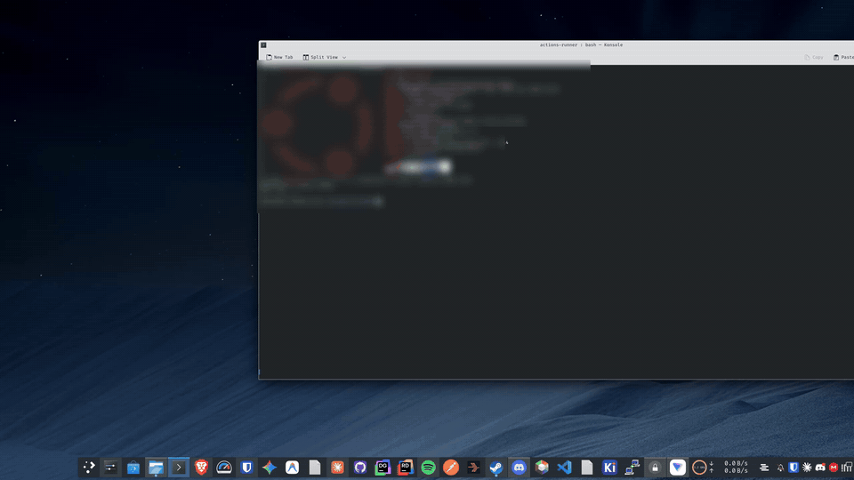
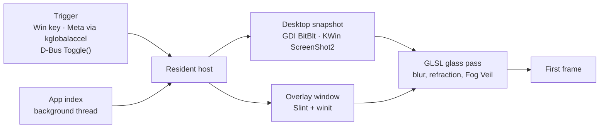

<div align="center">

# Rusty Start

**A performance-focused Start menu and app launcher, written in Rust, with GPU-rendered liquid glass.**

[](https://github.com/jav76/rusty-start/actions/workflows/ci.yml)
[](LICENSE)
[](https://rustup.rs)
[](#requirements)
[](https://slint.dev)
[](#highlights)



<sub>Tap Meta, pin and launch an app, then search and open the power menu. Real time, KDE Plasma 6 on Wayland.</sub>

</div>

Rusty Start replaces the Windows 11 Start menu, and runs as an app launcher on Linux with KDE
Plasma 6 on Wayland. Tap the Windows (Meta) key and a frosted glass card appears over a blurred
snapshot of your desktop, ready to search before you finish typing.

## Highlights

- **Fast to open.** The trigger-to-first-frame path does no disk I/O and no work proportional to
  installed apps. On a 3440x1440 Plasma desktop the first frame lands 43-75 ms after the key tap,
  desktop snapshot included, and the app index (153 apps) builds in 9 ms on a background thread.
- **Liquid glass on the GPU.** A custom GLSL pass blurs the desktop through a dual-Kawase mip
  pyramid and refracts it through the card's bevel with chromatic dispersion, all animated from
  zero.
- **Keyboard first.** Search as you type, Enter to launch, Ctrl+P to pin. Results rank by match
  quality, then by how often and how recently you launch each app.
- **Native on both platforms.** Windows uses Win32, COM and a GDI snapshot. Linux uses D-Bus,
  kglobalaccel, KWin ScreenShot2, Desktop Entry and Icon Theme parsing, and launches apps into
  their own systemd scopes. One Linux binary probes each capability at runtime and falls back
  gracefully.
- **Built to be maintained.** Platform backends share one API per module, a preview backend runs
  the full UI on any OS, and CI runs fmt, clippy (Linux, preview and cross-target Windows) and tests.

## How it works



The host stays resident with its window hidden, so opening the menu only captures the screen,
uploads one texture and renders. If the desktop snapshot is unavailable or takes longer than
100 ms, the menu opens as **Plain Glass**: a dimmed veil with an unrefracted card, so it never
waits on the compositor.

## Requirements

- Windows 11, or Linux with KDE Plasma 6 on Wayland (tested on Debian 13). Other Linux desktops run
  the menu without the Meta key binding or desktop snapshots.
- Rust 1.92 or later from [rustup](https://rustup.rs). Debian's packaged Rust is too old.
- On Linux: `pkg-config` and `libfontconfig-dev` to build.

## Building and running

```
cargo build --workspace
cargo run -p rusty-start-host
```

Debug builds show a console window for diagnostic output on Windows; release builds do not. Only one
host runs per session: launching `rusty-start` again toggles the running host's menu and exits.

Known limitation on Windows: clicking the taskbar Start button still opens the native Start menu.
The Windows key is the supported trigger.

## Installing on Windows

Releases ship a `.zip` for x64 and arm64 (Windows on ARM). Extract it anywhere and run
`rusty-start.exe`. The binaries are not code-signed, so SmartScreen may ask before the first run.

To start Rusty Start at sign-in, open **Settings > Setup** in the menu and choose **Install**, or run
`rusty-start setup`. It adds a `RustyStart` value under
`HKCU\Software\Microsoft\Windows\CurrentVersion\Run` that points at the running executable;
**Undo** or `rusty-start setup --undo` removes it. If you move the folder later, the Setup section
reports the value as pointing at another copy, and Install updates it.

## Installing on Linux

Releases ship a `.deb` and a `.tar.gz` for amd64 and arm64. The package installs `/usr/bin/rusty-start`,
its desktop entry and a D-Bus service file, so a Meta tap starts the host when it is not running.

```
sudo apt install ./rusty-start_*.deb
rusty-start setup
rusty-start
```

`rusty-start setup` is run once per user and prints every change it makes. On KDE Plasma it:

- moves the Meta key from the Application Launcher to Rusty Start's KDE global shortcut ("Toggle
  the menu" under System Settings > Shortcuts), keeping the launcher's other shortcuts such as
  Alt+F1,
- adds a KWin window rule that keeps the menu out of the taskbar and task switcher,
- adds an autostart entry, and reloads KWin.

`rusty-start setup --undo` reverses all of it and gives the Meta key back to the Application
Launcher. `rusty-start setup --check` prints the Setup Audit: whether each piece is installed,
missing or in conflict. The **Setup** section of the in-menu Settings Page shows the same audit and
runs Install and Undo (Undo asks for a second press). On other desktops, bind a keyboard shortcut to
`rusty-start` instead: a second launch toggles the menu.

Running from a build directory (`cargo run`), add `--dev`: `rusty-start setup --dev` also installs a
hidden desktop entry for the current executable. KWin only shares desktop snapshots with executables
listed in an installed desktop entry; without one the menu opens as Plain Glass.

## Usage

| Action                                 | Keys or mouse                                                 |
| -------------------------------------- | ------------------------------------------------------------- |
| Open or close the menu                 | Tap Win (Meta), or Ctrl+Alt+Space on Windows                  |
| Search                                 | Type while the menu is open                                   |
| Move the selection                     | Up and Down                                                   |
| Launch                                 | Enter, or click a row                                         |
| Pin or unpin the selected app          | Ctrl+P, or the pin button on a row                            |
| Show more actions for the selected app | Shift+F10 or the Menu key, or right-click a row               |
| Run the selected app as administrator  | Ctrl+Shift+Enter (Windows programs only)                      |
| Power options                          | Power button in the bottom-right corner, or search for them   |
| Open or close the Settings Page        | Ctrl+, or the gear button in the top-right corner             |
| Move between settings                  | Tab and Shift+Tab; arrow keys change the focused setting      |
| Back to the app list                   | Escape on the Settings Page, or the back arrow                |
| Close                                  | Escape, a click outside the card, or switching to another app |

- Windows shortcuts such as Win+R, Win+E and Win+Shift+S work as usual, with the menu open or closed.
  Right-clicking the Start button (the Win+X menu) is unaffected. On Plasma, Meta shortcuts keep
  working because KWin only calls Rusty Start for a Meta tap on its own.
- With an empty search the list shows **Pinned** apps, up to five **Recent** apps, then **All apps**.
  Search results rank apps you launch often and recently above others that match equally well.
- Search also finds apps by keyword: the generic name and keywords of their desktop entry on Linux
  (`terminal` finds Konsole), and their program file name on Windows (`mspaint`). These matches
  rank below matches on the app's name.
- The App Action Flyout lists what else can be done with an app: Pin or Unpin, then on Windows
  Run as administrator and Open file location for programs listed by file path, and Uninstall,
  which opens Settings > Installed apps. Packaged (Store) apps offer only Uninstall. On Linux it
  lists the app's own desktop entry actions (such as New Private Window) and Open file location,
  which shows the app's `.desktop` file. Up and Down move through it, Enter chooses, and Escape
  returns to the list.
- The Settings Page applies each change at once and saves it to `config.toml`: the card position
  (a 3x3 grid), the Veil Mode, the Fog Veil blur strength, whether the Meta (Windows) key opens the
  menu, and setup. On Plasma the Meta switch moves the key between Rusty Start and the Application
  Launcher, as setup does.
- Power actions found by search (for example `lock` or `shutdown`) are listed below the app results.
  Sign out, Restart and Shut down run only when selected a second time.
- The app list refreshes in the background when apps are installed or removed, and the new list
  appears the next time the menu opens. On Linux, apps come from `.desktop` files in
  `~/.local/share/applications` and the system and Flatpak application folders, and launched apps
  run in their own systemd scope, so they keep running if Rusty Start stops. Icons load after the
  list, so rows show a placeholder tile for a second or two after startup.

## Configuration

Settings live in `%APPDATA%\RustyStart\config.toml` (`$XDG_CONFIG_HOME/rusty-start/config.toml` on
Linux):

| Key                | Values                                                              | Default         |
| ------------------ | ------------------------------------------------------------------- | --------------- |
| `card_anchor`      | `top-left`, `top-center`, `top-right`, `middle-left`, `center`, `middle-right`, `bottom-left`, `bottom-center`, `bottom-right` | `middle-left` |
| `edge_margin`      | Inset from the screen edge in logical pixels, `0` to `512`          | `48`            |
| `veil_mode`        | `fog` (blurred and dimmed), `dim` (dimmed only), `off` (card only)   | `fog`           |
| `veil_blur`        | Fog Veil blur strength, `0` to `100`                                | `100`           |
| `use_win_key`      | `true` or `false`: open the menu with the Windows key (Windows only) | `true`          |

On Linux the Meta key binding belongs to the desktop, so `use_win_key` has no effect there; use the
Settings Page switch, `rusty-start setup` or `rusty-start setup --undo` instead.

Pins and launch history are saved to `usage.tsv` in the same folder.

If another application already owns Ctrl+Alt+Space, the host logs a warning and keeps running. Other
programs can toggle the menu by posting the `RustyStart.ToggleMenu` message to the
`RustyStart.TriggerWindow` window, after calling `AllowSetForegroundWindow` with the host's process ID
so the menu can take keyboard focus (see `crates/protocol`). On Linux, call `Toggle()` on the
session bus:

```
busctl --user call io.github.jav76.RustyStart /io/github/jav76/RustyStart io.github.jav76.RustyStart Toggle
```

## Development

CI runs in a `debian:bookworm` container on a self-hosted Linux runner for every push to `main` and
every pull request, and lints the Windows backend with cross-target clippy. Tagged releases build
on the same runner: Linux amd64 natively, Linux arm64 by cross-linking against Debian's multiarch
libraries, and Windows x64 and arm64 with [cargo-xwin](https://github.com/rust-cross/cargo-xwin).
Cross-built binaries are not run in CI. Run the same checks locally before opening a PR:

```
cargo fmt --all -- --check
cargo clippy --workspace --all-targets --locked -- -D warnings
cargo clippy -p rusty-start-host --all-targets --locked --features preview -- -D warnings
cargo test --workspace --locked
cargo test -p rusty-start-host --profile budget --locked -- --ignored
```

The last command is the per-keystroke latency budget: rebuilding the menu rows for 1,000 apps must
take under 1 ms in an optimized build. Run the host with `RUSTY_START_TRACE_OPEN=1` (debug builds
always do) to log the time to the first visible frame and from each keystroke to the frame that
shows its results.

`--features preview` builds the preview backend on any OS: the menu opens once at startup over a
synthetic desktop backdrop with a fixed sample app list, so the Liquid-Glass shaders and UI can be
iterated on without desktop integration. Windows integration can only be tested on Windows, and
Linux desktop integration on a Linux desktop session. [AGENTS.md](AGENTS.md) holds the coding
standards for contributors and coding agents.

## Project layout

| Path              | Purpose                                                                                      |
| ----------------- | -------------------------------------------------------------------------------------------- |
| `crates/host`     | Resident process: Liquid-Glass GPU shaders, desktop capture, Slint UI, triggers, app search, pins and power actions |
| `crates/protocol` | Window class, message names, mutex name and D-Bus names shared by the host and programs that toggle it |
| `GLOSSARY.md`     | Domain terminology such as the Fog Veil, Liquid-Glass Card, Card Anchor and Frecency          |
| `docs/adr`        | Architecture Decision Records                                                                |
| `packaging/linux` | Desktop entry and D-Bus service file installed by the `.deb`                                 |
| `AGENTS.md`       | Coding standards and workflow rules for contributors and coding agents                       |

## Support & Distribution Model

Rusty Start is developed as **convenience-ware / donationware**:

- **100% Free and Open Source**: The entire codebase is freely licensed under MIT. You can build from source, inspect the code, or download standalone releases for free.
- **Convenience Builds**: Packaged, auto-updating builds (e.g., Microsoft Store releases) are offered as convenience purchases to support active maintenance and feature development.
- **Donations & Sponsorship**: If Rusty Start improves your daily workflow, consider sponsoring development via [GitHub Sponsors](https://github.com/sponsors/jav76).

## License

Rusty Start is licensed under the [MIT License](LICENSE).

### Third-Party Licenses

- **Slint**: Rusty Start's UI is built with the Slint GUI toolkit. Binaries distributed for desktop use rely on Slint's Royalty-Free Desktop and Small Business License (or GPLv3). See the [Slint project](https://slint.dev) for licensing details and options.
