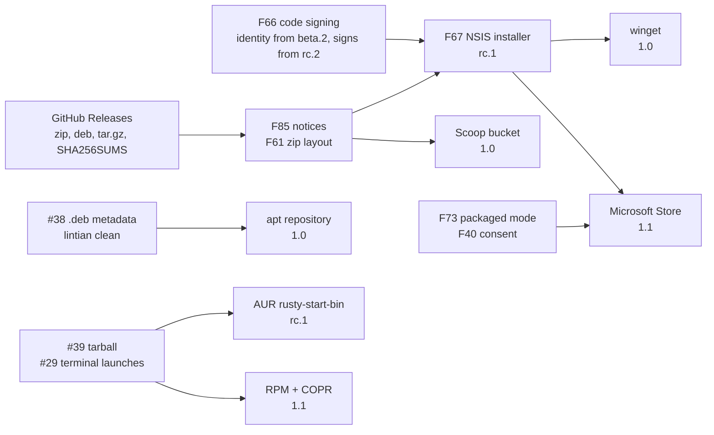

# Release candidate guide

What Rusty Start ships today, what has to land before `v1.0.0-rc.1`, where it can go after 1.0, and
how each publishing channel gets stood up. Written against `v0.1.2-alpha.1` on 2026-11-06.

This page is the entry point. The [roadmap](roadmap.md) holds the milestone order, exit criteria
and the full RC checklist; the [feature catalog](feature-catalog.md) holds every candidate feature
with its size and priority (`Fxx` below refers to it); the
[project board](https://github.com/users/jav76/projects/3) holds live status, and `#N` is an issue
or pull request there.

## 1. What Rusty Start has today

### Features

| Area | Windows 11 | KDE Plasma 6 (Wayland) |
| :--- | :--- | :--- |
| Trigger | Solo Windows-key tap through a low-level keyboard hook, with chord safety (Win+R, Win+E, Win+Shift+S keep working) and recovery after a lost key-up; Ctrl+Alt+Space as a second hotkey | Meta tap through a kglobalaccel shortcut registered in-process; `Toggle()` and `ToggleWithToken()` on the session bus; D-Bus activation starts the host on demand |
| Backdrop | GDI `BitBlt` snapshot of the cursor's monitor | KWin `ScreenShot2` snapshot, authorized through the installed desktop entry |
| Rendering | One GLSL pass: dual-Kawase blur pyramid, Fog Veil dim, Liquid-Glass Card with bevel refraction, chromatic dispersion and fresnel; 180 ms Optical Condense open, 100 ms dismiss | Same shader; the overlay is a fullscreen winit window with the `appletpopup` Plasma role |
| Plain Glass fallback | When the snapshot takes longer than 100 ms | When KWin refuses or is absent, and after the 100 ms wait |
| App index | Shell `AppsFolder` enumeration on a background thread, icons after the list, refresh when apps change | Desktop entries from user, system and Flatpak folders, Icon Theme lookup with SVG rendering, refresh on folder changes |
| Search | Ranked tiers (exact, prefix, word prefix, initials, keyword, substring), frecency tie-break, power actions below apps; under 1 ms per keystroke at 1,000 apps | Same engine; keywords come from `GenericName` and `Keywords` |
| Browsing | Pinned, up to five Recent, then All apps; Ctrl+P pins | Same |
| App Action Flyout | Pin or Unpin, Open file location, Run as administrator, Uninstall (Store apps: Uninstall only) | Pin or Unpin, the entry's own desktop actions, Open file location |
| Launch | `ShellExecute` by AppUserModelID or path; Ctrl+Shift+Enter elevates | `Exec` parsing with field codes, D-Bus activation when offered, each launch in its own systemd scope |
| Power | Lock, Sign out, Sleep, Restart, Shut down, found by search too; destructive ones need a second press | Same, through the session manager and logind |
| Settings Page | Card Anchor (3x3 grid), Veil Mode, blur strength, Windows-key switch, Setup Audit with Install and Undo, version, Quit | Same; the Meta switch moves the key between Rusty Start and the Application Launcher |
| Setup | `rusty-start setup` writes the `HKCU` Run value; `--undo`, `--check` | Moves Meta from Kickoff, adds a KWin window rule and an autostart entry, reloads KWin; `--dev` adds a snapshot-authorized dev entry; `--undo`, `--check` |
| Persistence | `config.toml` (comments and unknown keys survive), `usage.tsv` (pins and launch history), damaged files moved aside, saves flushed before sign-out | Same paths under `$XDG_CONFIG_HOME` |
| Diagnostics | `rusty-start.log` rotated at 1 MiB with panic reports, `RUSTY_START_LOG`, `RUSTY_START_TRACE_OPEN` timings, message box when there is no console | Same, to stderr as well |
| CLI and IPC | `toggle`, `quit`, `setup`, `--version`, `--help`; `RustyStart.ToggleMenu` and `RustyStart.QuitHost` window messages; single-instance mutex | Same CLI; `Toggle()`, `ToggleWithToken(s)`, `Quit()` on `io.github.jav76.RustyStart` |

Not supported today: clicking the taskbar Start button (the explorer hook was withdrawn), Windows 10, Plasma on
X11, desktops other than Plasma (the menu runs, but without the Meta key or desktop snapshots), and
macOS (no backend exists; see [Homebrew](#54-homebrew)).

### Performance today

| Measurement | Value | Where it is enforced |
| :--- | :--- | :--- |
| Trigger to first visible frame, 3440x1440 Plasma desktop | 43-75 ms, snapshot included | Hand-checked with `RUSTY_START_TRACE_OPEN`; 75 ms target, 100 ms hard limit |
| Snapshot wait before Plain Glass | 100 ms | `menu.rs` |
| Row rebuild for one keystroke at 1,000 apps | under 1 ms | Ignored budget test, `--profile budget`, runs in CI |
| App index build, 153 apps | 9 ms on a background thread | Logged |
| Search frame after a keystroke | within 16 ms | Hand-checked |

### Architecture in brief

Two crates, about 13,000 lines of Rust and Slint. `crates/host` is the resident process: Slint UI
compiled from `crates/host/ui`, the GLSL pass in `glass.rs`, and one module per capability
(`apps`, `backdrop`, `trigger`, `power`, `setup`, `instance`) with `win32.rs`, `linux.rs` and
`preview.rs` behind an identical API, selected by cfgs from `build.rs`. `crates/protocol` holds the
names other programs use to toggle or stop the host. The `preview` feature runs the whole UI on any
OS over a synthetic backdrop. The host makes no network calls.

### Release pipeline today

| Stage | What runs | Gap |
| :--- | :--- | :--- |
| CI (`ci.yml`) | `debian:bookworm` container on the self-hosted runner: fmt, clippy for Linux, the preview backend and cross-target Windows, tests, the latency budget, and a check that `CHANGELOG.md` has a section for the Cargo version | Windows tests never run; no Windows runner exists |
| Release (`release.yml`) on `v*` tags | Tag must equal the Cargo version and have a changelog section; draft release with the section as notes; Linux amd64 native and arm64 cross-linked; Windows x64 and arm64 through cargo-xwin with a static CRT; `.deb` through cargo-deb; `SHA256SUMS`; prerelease flag for tags with `-`; published only when every asset uploaded | Cross-built binaries are never run; nothing is signed; no third-party notices; no attestations or SBOM; no installer; release jobs share the runner with PR jobs |
| Artifacts | `rusty-start-vX-windows-{x64,arm64}.zip`, `rusty-start_X_{amd64,arm64}.deb`, `rusty-start-vX-linux-{amd64,arm64}.tar.gz`, `SHA256SUMS` | Zip folder carries the version, so every upgrade breaks the Run value; the tarball hard-codes `/usr/bin` (#39) |
| Releases so far | `v0.1.0-alpha.1`, `v0.1.1-alpha.1`, `v0.1.2-alpha.1`, all unsigned prereleases | The first two share package version 0.1.0, so apt never upgraded between them |

## 2. What "release candidate" means here

The roadmap fixes the rules, so the RC is a defined event rather than a feeling:

- Versions run `v0.2.0-beta.N` (beta chain, legal, never lose the menu), `v0.3.0-beta.N` (parity,
  accessibility, first run), `v1.0.0-rc.N`, `v1.0.0`.
- `v0.3.0-beta.2` declares the feature freeze. `rc.1` follows after 14 days with no open P0 and no
  data-loss or dead-trigger report. After `rc.1` only P0 and P1 fixes and regressions merge.
- Severity: P0 blocks an RC (dead trigger, data loss, crash loop, security, legal). P1 is expected
  by most users before 1.0. P2 is valuable, P3 nice to have.
- Every RC is checked against the [RC checklist](roadmap.md#release-candidate-checklist) on the
  draft artifacts, recorded in a sign-off issue, and signed from `rc.2`.
- Nothing in the host talks to the network. Updates arrive through the channels in section 5.

## 3. Essential before the release candidate

The roadmap schedules about 80 catalog entries before `rc.1`. The groups below are the ones that
decide whether an RC is credible, in the order they should land. Each row says why it cannot slip
and how it is verified.

### 3.1 Never lose the Start menu

A launcher that replaces the Start menu has one unforgivable failure: the key does nothing. Every
item here is a known path to that state.

| Ref | Work | Why it blocks | Verified by |
| :--- | :--- | :--- | :--- |
| F20 | Keep the Windows-key hook alive: hook thread does nothing but hook and post, reinstall on resume, unlock and `TaskbarCreated` | Windows silently removes a hook that stalls; the user gets neither menu | Win opens the menu after sleep, Win+L, a cancelled shutdown and an Explorer kill |
| #33 | Survive an Explorer restart | Same dead trigger from the other side | Kill and restart `explorer.exe`, tap Win |
| F21 | Meta works when the host is not running on Plasma: give Meta back to Kickoff on quit, retake at start, restart on failure through a systemd user unit | Today quit, crash, `apt upgrade` and `apt remove` all leave Meta dead | After `rusty-start quit` Meta opens Kickoff; after `kill -9` the host is back |
| F93 | Re-register the shortcut when kglobalacceld restarts | A Plasma update kills the binding | Restart kglobalacceld, tap Meta |
| F99 | Fail open: pass Win through when the UI thread heartbeat is stale or GL is missing (#37 decides the renderer fallback) | A hung UI or a VM without GL must still produce some Start menu | Simulated hang and no-GL run open the native menu |
| F50, F100 | `panic = "abort"`, `RegisterApplicationRestart`, a crash-loop guard with a post-crash notice | A resident process with no supervisor | Forced panic restarts once; three crashes in ten minutes start with the hook off and say so |
| F22, F23, F24 | Never leave the menu open without focus; accept injected Win taps; Ctrl+Esc and a configurable hotkey | Typing into the wrong window, remappers and KVMs, keyboards without a Win key | Manual rows in the QA matrix |

### 3.2 Legal and trust

Every download already shipped owes two things, and signing has a lead time measured in weeks.

| Ref | Work | Why it blocks | Verified by |
| :--- | :--- | :--- | :--- |
| F86 | Slint royalty-free attribution: the Made with Slint badge in the README and release notes, the right license name | Condition of the license the binaries ship under | Badge visible; `AboutSlint` optional |
| F85 | `THIRD-PARTY-NOTICES` generated with cargo-about in every zip, tarball and `.deb`, stale notices fail CI | Dependency licenses require it | `unzip -l`, `tar tf`, `dpkg -c` list the file |
| F110 | Trademark review: no Windows, KDE or Rust marks in the icon, a not-affiliated line | Takedown risk once the icon is final (F64) | Checklist in the PR |
| F79, F80 | Tags only from `main` with green CI; release jobs on an ephemeral runner behind a protected environment that holds every secret | A PR must never be able to reach a signing key or publish token | Ruleset on `refs/tags/v*`; PR jobs cannot see the release label |
| F66 | Code-sign the exe, installer and uninstaller from `rc.2` | Smart App Control blocks unsigned binaries outright; SmartScreen warns on every first run | `osslsigncode verify` shows a valid signature and timestamp |
| F107 | Secrets scoped to the release environment, published fingerprints, rotation steps in `RELEASING.md` | Needed before the AUR key, apt key and signing credentials exist | Documented and reviewed |

Identity validation for signing takes 1 to 20 business days, so it starts in `v0.2.0-beta.2` even
though signing itself begins at `rc.2` (details in [Windows code signing](#code-signing)).

### 3.3 Correct on real machines

| Ref | Work | Why it blocks | Verified by |
| :--- | :--- | :--- | :--- |
| F48, #32 | Embedded manifest with per-monitor v2 DPI awareness; clamp the card to small screens and re-lay-out on scale change | Every high-DPI Windows user sees a blurry or misplaced card today | Task Manager shows Per-monitor (v2); two monitors with different scales |
| F77 | Run `cargo test` and a start/toggle/quit smoke natively on Windows in CI | The shipped `.exe` has never been executed by CI | A green Windows job |
| F61 | `Rusty Start/` as the zip's top folder, version only in the archive name | Every beta-to-beta upgrade breaks the autostart Run value | `unzip -l` |
| F62, F63 | A newer binary replaces the running host (`--replace`); upgrade and uninstall steps that leave nothing dead | Package upgrades must not leave the old process holding the hotkey | Install a newer package over a running host on both OSes |
| F64 | Icon, `VERSIONINFO`, hicolor PNGs | Explorer, Task Manager, `.deb` metadata and the installer all need it | Resources present in the `.exe` and `.deb` |
| #38, #39 | Complete `.deb` metadata (maintainer, depends `libegl1` and `libxkbcommon0`, `postinst kbuildsycoca6`, `prerm` that quits the host, AppStream metainfo) and a tarball with templated paths | Lintian-clean before an apt repository; AUR and RPM build from the tarball | `lintian --fail-on warning` clean |
| F30, F37 | Tab never drops typed characters; `LANGUAGE` honored for app names | Pure fixes users hit daily | Manual on both OSes; unit test |

### 3.4 Data safety and the 1.0 contract

| Ref | Work | Why it blocks | Verified by |
| :--- | :--- | :--- | :--- |
| F55 | Compatibility contract: config keys and defaults, `usage.tsv` v1, CLI and exit codes, protocol names, file locations, semver rules; fixture tests for files from every shipped alpha | 1.0 promises that pins, history and scripts survive upgrades and downgrades | Fixture tests pass; unknown usage records survive a save |
| F94 | Decide how `config.toml` grows (flat keys for 1.0, lists elsewhere) | Feature betas add keys and the RC freezes the format | Decided before `v0.3.0-beta.1` |
| F95 | Flush the debounced config writer on `SIGTERM` | A setting changed just before logout is lost on Linux today | Change a setting, log out, log in |
| #31 | Show launch failures and record only successful launches | Frecency must not learn from failed launches | Launch a removed app |
| F105 | Property tests for desktop entry, icon theme, config and usage parsers; no panic path inside the hook | A malformed file must never kill the trigger | proptest suite in CI |

### 3.5 Daily-driver parity

The P1 items that send users back to the native menu when missing. These are the ones the
in-or-out call at `v0.3.0-beta.1` may trim, in this order of least regret: F44, #11, F13, F11.

| Ref | Work | What users get |
| :--- | :--- | :--- |
| #12 | Search settings pages | `display`, `bluetooth` reach Settings and System Settings |
| #13 | Opt-in Web Fallback | A last row that opens the query in the browser, off by default |
| F42, F43 | Hide apps; remove from Recent, clear and disable history | Control over what the menu shows and remembers |
| F01 | Diacritic folding | `parametres` finds Paramètres |
| F11, F13 | Hand the foreground to launched apps and the UAC prompt; outbound xdg-activation tokens | Launched apps open in front on both platforms |
| #11 | Reorder pins from the keyboard and the flyout | Curated pins |
| F44 | Choose what the empty menu shows | A pins-only menu |

### 3.6 Accessibility and first run

| Ref | Work | Why before the RC |
| :--- | :--- | :--- |
| F31 | Labeled search field, live region, row index and count, flyout announcements | A 1.0 accessibility claim needs Narrator and Orca to work |
| F32, F34 | Clamp card luminance to 4.5:1 for primary text; opaque card under contrast themes and with transparency off | Text is about 2.2:1 over a white wallpaper today |
| F33 | Reduced motion: opacity-only ramp from the same progress value | Respects the OS setting; host code must land before the freeze |
| F40, F41 | First-run welcome, consent before `use_win_key`, autostart prompt; a keyboard shortcut list | First impression, and the Store's consent policy later |
| F38 | Touch pin hit target | A tap at the row's end pins instead of launching |

### 3.7 Diagnosable and documented

| Ref | Work | Why before the RC |
| :--- | :--- | :--- |
| F52, F53 | Startup header (version, commit, target, OS, GL renderer), backtraces with a symbols archive, `rusty-start report` and Open log folder | RC bug reports must be actionable from one paste |
| F88 | `SECURITY.md` with private vulnerability reporting, `CONTRIBUTING.md`, issue forms, PR template | Testers need channels |
| F87 | `PRIVACY.md` and a README section: no network, what the hook sees, what is stored | Reviewers and the Store ask for it |
| F89, F92 | Troubleshooting guide; `SUPPORT.md` with Tier 1 (Windows 11 x64; Plasma 6 Wayland on Debian 13 and Kubuntu 26.04), Tier 2 and unsupported | Defines what the QA matrix must pass |
| F96, F113 | Docs audit against the RC build; config, CLI and known-limitations reference with a test that fails on an undocumented key | The frozen contract has to be written down |

### 3.8 Release engineering for the RC itself

| Ref | Work | Why before the RC |
| :--- | :--- | :--- |
| F78, F112 | `docs/qa/matrix.md`, an RC sign-off issue template, 5 or more external testers on Tier 1 configurations | Integration that CI cannot test is checked the same way every RC |
| F81 | Verify job before undrafting: `apt install` in trixie and ubuntu:24.04, lintian, arm64 under qemu, wine `--version`, import checks (no `VCRUNTIME140`, no network functions) | Broken packages are caught before download |
| F82, F83 | Attestations over every asset, immutable releases, cargo-auditable, CycloneDX SBOM; cargo-deny with a license allowlist and a ban on HTTP, TLS and socket crates; a `cargo +1.92 check` MSRV job | The no-network and MSRV promises become checkable |
| F104, F54 | 1,000 toggles plus a 24 h resident run with memory, handle and GPU memory counters; idle footprint recorded per RC | A resident process must not leak |
| F67, F106 | Per-user NSIS installer (unsigned in `rc.1`, signed from `rc.2`); tested migrations between zip, installer, winget and apt | The installer must be QA'd in an RC, not first shipped at 1.0 |
| F65 | AUR `rusty-start-bin` | Cheap, and it recruits Arch testers during the RC window |
| F109 | Threat model for D-Bus and window-message callers; a test that logs never contain typed queries | Feeds `SECURITY.md` |

### How much of this is truly essential

| Option | Pros | Cons | Design considerations |
| :--- | :--- | :--- | :--- |
| **A: Minimum RC** (3.1, 3.2, 3.3, 3.4, 3.7, 3.8 only; 3.5 and 3.6 move to 1.1) | • Reaches `rc.1` two betas sooner • Every remaining item is a defect, legal need or process gate, so scope is hard to argue | • 1.0 cannot claim accessibility or settings search • Hidden apps and history controls arrive after the compatibility contract froze `usage.tsv`, so they need a format bump | • The F55 contract is written without the record types F42 and F43 add • First run (F40) is where the Store's consent policy is met, so the Store build also slips |
| **B: Roadmap as written** (all of section 3, in-or-out calls at `v0.3.0-beta.1`) | • 1.0 is a daily driver for non-English, keyboard-only and screen-reader users • `usage.tsv` and `config.toml` freeze once, with every 1.0 record type known | • About 80 entries before `rc.1`; two more beta cycles • Risk that parity work keeps reopening the freeze | • Trim order for 3.5 is fixed in advance, so the call is a date decision, not a design one |
| **C: RC from the current alphas** (ship `rc.1` after the beta chain) | • Fastest possible | • Known dead-trigger paths, unsigned binaries, no notices, no DPI manifest: every P0 in the catalog is open | • An RC that fails its own P0 definition is a renamed alpha |

Recommendation: **B**, with 3.1 to 3.4 and 3.8 treated as hard gates and 3.5 to 3.6 as the
in-or-out list, trimmed in the order given above if the second feature beta runs long. Option A is
the fallback if the beta cycle shows the trigger work (3.1) alone consumes the time budgeted for
3.5. Option C is not an option: the catalog's P0 definition is what makes the RC label mean
something.

## 4. Possible future enhancements

The catalog places 122 entries. The ones below are after 1.0, grouped by what they add. Sizes: S is
a day or two, M a week, L weeks, XL a project.

| Theme | Entries | What they add |
| :--- | :--- | :--- |
| Search sources | #14 async lane with recent files, #15 own file-name index, F02 typo tolerance, F04 remembered picks and aliases, F05 known folders and places, F08 user-defined commands, F07 run command, F06 calculator, F09 window switching, F10 Everything integration | Search beyond apps while per-keystroke work stays under the budget: I/O-backed sources run on one async lane and always rank below sync results |
| Personalization | F47 import pins from Start or Kickoff, F121 All apps folder rows, F46 letter headers, F35 system text scale, F36 translations, #16 theme tokens shared with the glass and the system accent | A menu that looks and reads like the rest of the desktop |
| Windows depth | F18 Update and shut down and Hibernate, F14 flyout actions from shell properties, F12 refreshed environment after PATH changes, F116 ignore Win in full-screen apps, F26 Win over elevated windows (uiAccess or an elevated start), F19 per-app recent documents | Parity with what Start offers power users |
| Linux reach | F56 exact non-Plasma setup steps, F58 a decision on Plasma X11, F57 icon theme on GNOME and Cinnamon, F15 manage apps through the software center, F16 discrete-GPU launches, F59 a Plasma panel widget, F60 layer shell and wlroots capture (XL) for Sway, Hyprland, niri and COSMIC | One binary that does more on each desktop it finds |
| Robustness | F122 GPU context loss recovery, F98 persisted icon cache for the first open after sign-in, F124 deterministic archives and cosign | Fewer blank menus, faster cold starts, reproducible releases |
| Touch and input | F119 long press and a visible flyout button, F117 press-to-record shortcut field, F39 Alt+digit launch, F120 glass tooltips | Reach without a keyboard |
| Distribution | F73 MSIX packaged mode, F74 the Microsoft Store build, F70 RPM with a Fedora COPR, F75 vendored source tarball, F76 the protocol crate on crates.io | Section 5 covers each |

Ideas that are not in the catalog yet, and would need their own entries before scheduling:

- **A macOS backend.** Nothing exists: no trigger (a global event tap for a modifier tap), no
  capture (ScreenCaptureKit with the Screen Recording permission), no app index (Launch Services)
  and no overlay model. The preview backend compiles on macOS, so the shaders and UI already run
  there. This is the only route to a meaningful Homebrew channel; see section 5.4. XL.
- **Taskbar Start clicks** through a low-level mouse hook in the host, the robust option identified
  when the injected DLL was withdrawn. Needs the Windows CI from F77. M.
- **A light theme**, deferred in #6; F118's contrast-theme colors are the accessibility exception
  that lands first.
- **Multiple pin pages or groups**, once #11 reordering exists. Not requested yet.

Out by design, so not enhancements: network calls or telemetry inside the host (updates come from
package managers), a plugin runtime (F08 user-defined commands exist instead), Windows 10 support,
and sandboxed packaging that breaks desktop integration (section 5.3).

## 5. Publishing path by platform

The overview, then one section per channel with what it needs from the code, what it needs from the
project, and what it costs. Channel dependencies:

| Channel | Platform | Milestone | Needs first | Cost | Today |
| :--- | :--- | :--- | :--- | :--- | :--- |
| GitHub Releases | Both | Shipping; canonical | F85 notices, F61 zip layout, F80 isolated runner, F81 verify job, F82 attestations | Free | Unsigned prereleases with `SHA256SUMS` |
| Windows code signing | Windows | Identity in `v0.2.0-beta.2`, signing from `rc.2` | F64 branding, the F90 distribution decision, F80, F107 | Azure Artifact Signing Basic tier monthly fee, or a Certum open-source certificate | None |
| NSIS per-user installer | Windows | `rc.1` unsigned, `rc.2` signed | F62, F63, F64 | Free | None |
| winget | Windows | `v1.0.0` | Signed installer, F80 for the token | Free | None |
| Scoop (own bucket) | Windows | `v1.0.0` | F61 | Free | None |
| Microsoft Store | Windows | `v1.1.0` | F73 packaged mode, F40 consent, F87 privacy URL | Free registration; 15% commission on paid sales | None |
| `.deb` on Releases | Linux | Shipping; #38 in `v0.2.0-beta.3` | #38 | Free | Installs, incomplete metadata |
| apt repository | Linux | `v1.0.0`, testing suite during the RC window | #38, F80 | Free on Cloudsmith's open-source plan with attribution | None |
| AUR `rusty-start-bin` | Linux | `rc.1` | #39, #29, F85 | Free | None |
| Linux tarball | Linux | `v0.2.0-beta.3` with templated paths | #39 | Free | Ships, undocumented |
| RPM and Fedora COPR | Linux | `v1.1.0` | #39, #29, F85 | Free | None |
| Homebrew | Linux, macOS | Not planned | A macOS backend for it to matter | Free | None |
| crates.io, nixpkgs, OBS, PPA | Both | Later | F55 stability promise, F75 vendored tarball | Free | None |
| Flathub, Snap, AppImage, MSI, Chocolatey, KDE Store | Both | Not shipped | F90 records why | n/a | None |

### 5.1 GitHub Releases

The canonical channel and the source every other channel points at. The flow exists; what changes
before the RC:

1. `v0.2.0-beta.2`: notices in every archive (F85) and `Rusty Start/` as the zip folder (F61).
2. `v0.2.0-beta.3`: release jobs move to an ephemeral release-labelled runner behind a protected
   environment (F80). No release secret exists before this.
3. `rc.1`: a verify job smoke-tests every artifact before undrafting (F81); attestations with
   `actions/attest`, an SBOM per target from cargo-auditable and CycloneDX, and immutable releases
   turned on (F82). Release notes gain the Slint badge, toolchain versions and known issues.
4. `rc.2`: Windows binaries and the installer are signed.

Users verify with `sha256sum -c SHA256SUMS` today and `gh attestation verify` from `rc.1`. On a
self-hosted runner the attestation proves the workflow and commit, not the hardware, which the docs
should say.

A note on tooling: `dist` (formerly cargo-dist) is maintained and would generate installers, a
Homebrew formula and the release workflow, but it assumes GitHub-hosted runners and its own asset
layout. The hand-written `release.yml` already fits the self-hosted runner, cross-linking and
cargo-xwin, so it stays.

### 5.2 Windows

#### Portable zip

Ships today. Keep it alongside the installer for users who want nothing written outside a folder.
After F61 the upgrade path is "quit, extract over"; the Setup Audit already reports a Run value that
points at another copy.

#### NSIS installer (`rc.1`)

Built with `makensis` from Debian's `nsis` package in the Windows release job, so no Windows build
machine is needed. Per-user: installs to `%LOCALAPPDATA%\Programs\Rusty Start`, writes an `HKCU`
Uninstall entry, supports `/S`, runs `rusty-start quit` before replacing files and relaunches after,
migrates a Run value that points at an old zip folder, runs `setup --undo` on uninstall, and creates
a Start Menu shortcut that the app index excludes. winget's installer validation needs exactly this:
silent install, clean uninstall, works for administrators and non-administrators.

#### Code signing

Why it is P0: Smart App Control, which clean Windows 11 installs can turn on after its evaluation
period, blocks unsigned binaries outright, and SmartScreen warns on every first run until reputation
builds. winget's validation also runs Defender against the installer.

| Option | Pros | Cons | Design considerations |
| :--- | :--- | :--- | :--- |
| **Azure Artifact Signing** (formerly Trusted Signing) | • Microsoft-managed certificate, short-lived, no key to protect • Signs from Linux through jsign with an RFC 3161 timestamp • Builds SmartScreen reputation fastest | • Public Trust for individual developers is limited to the United States and Canada (organizations: a longer country list); the Azure billing account must be an Individual account whose legal name and address match the government ID • Identity validation takes 1 to 20 business days • Monthly fee for the Basic tier | • Credentials are an Entra app registration or workload identity, scoped to the release environment • Fits the existing bookworm container with one Java tool added |
| **Certum open-source code signing** | • Priced for open-source projects, one-off • Available outside North America | • Issued to a cryptographic card or Certum's cloud signing service, so either a token on the runner host or their client in the container • Reputation builds more slowly than with Microsoft's CA | • A hardware token ties releases to one machine, which fights F115's runner continuity |
| **SignPath Foundation** | • Free for qualifying open-source projects | • Requires builds on their approved CI, which excludes self-hosted runners | • Would mean moving release builds off the project's runner |

Recommendation: Artifact Signing if the maintainer qualifies as an individual in the United States
or Canada, with Certum as the fallback; record the choice under F90 and submit validation in
`v0.2.0-beta.2`. Confirm the current Basic tier price on the Azure pricing page before committing;
the roadmap's figure dates from its research pass.

Steps: pick the identity, create the account and identity validation in the Azure portal, add jsign
to the release container, sign the exe then the installer and uninstaller with a timestamp, verify
with `osslsigncode verify`, and submit each release to Microsoft's false-positive portal (F108)
until reputation holds.

#### winget (`v1.0.0`)

The community repository (`microsoft/winget-pkgs`) takes a manifest per version under
`manifests/j/jav76/RustyStart/<version>`. Its policies, as of the current docs:

- The installer must install and uninstall correctly for administrators and non-administrators and
  support a non-interactive mode. The NSIS `/S` switch covers this.
- `InstallerUrl` must be HTTPS and come directly from the publisher's release location. GitHub
  release asset URLs qualify; URL shorteners and redirectors fail validation.
- Every submission runs through Defender and other antivirus engines, a URL reputation check and
  an install, uninstall and hash check in a sandbox, then a moderator reviews it. One manifest per
  pull request.
- Packages needing the Visual C++ runtime must declare it; the static CRT avoids this.

The repository has no release channels, so a prerelease manifest would be offered to everyone by
`winget upgrade`. Publish stable versions only. First manifest by hand with `komac new` during the
RC window (installer type `nullsoft`, x64 and arm64; a `zip` installer with a nested `portable` is a
possible second entry), then `komac update --submit` from `release.yml` for tags without `-`, using
a token kept in the release environment. Identifier: `jav76.RustyStart`.

#### Scoop (`v1.0.0`)

The main bucket is out: it admits only non-GUI developer tools and its example notability bar is 500
stars and 150 forks. Extras takes GUI apps and judges popularity case by case without a published
number. Start with an own bucket (`jav76/scoop-bucket`) whose `rusty-start.json` is generated by
`release.yml` from the zip and `SHA256SUMS`; request Extras once the project has visible adoption.
Document `rusty-start quit` before `scoop update`, since Scoop replaces files in place.

#### Microsoft Store (`v1.1.0`)

Registration for individual developers has been free since September 2025, with identity
verification by ID and selfie. Microsoft keeps 15% of app sales through its commerce platform, which
is what makes the paid convenience build possible. Prerequisites in the code: MSIX packaged mode
(F73: package identity detection, `windows.startupTask` for autostart, the virtualized config path,
an `appExecutionAlias` so the CLI keeps working, `runFullTrust`), the first-run consent step (F40)
for policy 10.2.8 because the hook watches every key event, and a privacy URL (F87). The Store signs
the package, so this channel does not need the project's own certificate. Submissions go through the
`msstore` CLI. Building an MSIX on the Linux runner is unverified; a hosted Windows job may be
needed for this one artifact.

#### Not planned on Windows

Chocolatey moderates every version by hand and adds nothing winget does not. MSI through WiX is
Windows-only to build and WiX v5 carries an open-source maintenance-fee model for some users.
`cargo binstall` would work for the zip with a `[package.metadata.binstall]` URL template, at no
cost, if a developer-oriented channel is wanted.

### 5.3 Linux

#### `.deb` on Releases (shipping)

cargo-deb builds it from `[package.metadata.deb]`. #38 completes it: `maintainer`, `depends` with
`libegl1` and `libxkbcommon0`, `Icon=` and AppStream metainfo, a `postinst` running `kbuildsycoca6`
so KWin sees the desktop entry at once, and a `prerm` that runs `rusty-start quit`. The verify job
runs `lintian --fail-on warning`. Prerelease versions already sort correctly: tag `v0.2.0-beta.1`
becomes package version `0.2.0~beta.1-1`, below `0.2.0-1` and above `0.1.0-1`.

#### apt repository (`v1.0.0`)

Discover and `apt upgrade` need a signed repository, not a `.deb` link.

| Option | Pros | Cons | Design considerations |
| :--- | :--- | :--- | :--- |
| **Cloudsmith open-source plan** | • Free: at least 50 GB storage and 200 GB delivery per month across open-source repositories • Signing, metadata and CDN handled • Separate suites for stable and testing | • Requires attribution with a link back to Cloudsmith • Eligibility review against the public project URL • A third party in the update path | • An API token in the release environment (F80) • `-beta` and `-rc` tags push to a testing suite so `rc.N` exercises an apt upgrade |
| **Self-hosted on GitHub Pages** (reprepro or aptly) | • No third party, no attribution • Repository is a git branch | • The project owns a long-lived GPG key and its rotation • Pages has size and bandwidth limits • More release steps to get wrong | • Key management lands on F107 either way |
| **Launchpad PPA** | • Native to Ubuntu | • Builds from source on Launchpad with the distro's toolchain, so it needs a vendored tarball and a versioned `rustc` stream • Ubuntu only | • Reasonable only after F75 exists |

Recommendation: Cloudsmith for 1.0, as the roadmap says, publishing a deb822 `.sources` file with
`Signed-By` and the attribution line in the README. Revisit self-hosting if the plan's terms change.

#### AUR `rusty-start-bin` (`rc.1`)

A `PKGBUILD` for `x86_64` and `aarch64` that installs the release tarball, with a `post_install`
hint to run `rusty-start setup`. Blocked on #39 (the tarball's `Exec=/usr/bin/rusty-start` is fine
for the AUR, but the install steps must be documented) and #29 (`Terminal=true` launches on
non-Debian distros). Pushed by a SHA-pinned deploy action from the release environment. Stable from
1.0; an `rc` `pkgver` is optional and would recruit Arch testers early.

#### RPM and Fedora COPR (`v1.1.0`)

`cargo-generate-rpm` with explicit `Requires` for `x86_64` and `aarch64`, attached to releases. COPR
builds from an SRPM in its own infrastructure, so the spec either builds from source with vendored
crates (Fedora's Rust is current enough for the MSRV) or repackages the release tarball. Fedora KDE
is Wayland by default, which makes it the natural second Tier 1 candidate once tested.

#### Flatpak, Snap and AppImage: why not

Rusty Start's integration depends on things a sandbox takes away:

- KWin hands desktop snapshots only to an executable listed in an installed desktop entry that
  carries `X-KDE-DBUS-Restricted-Interfaces`. A Flatpak runs from `/app` inside its own
  mount namespace, and an AppImage runs from a mount path that changes every start, so the
  authorization does not hold and the menu would be Plain Glass. Whether KWin accepts a Flatpak's
  exported desktop entry through its sandbox metadata is unverified and belongs in the F90 decision.
- The Meta key is a kglobalaccel shortcut registered directly on the session bus, and `setup`
  edits `kglobalshortcutsrc` and `kwinrulesrc`.
- Launches go into their own systemd scopes on the host's session bus, which a sandbox cannot
  create without a host-spawn escape.
- Snap would need classic confinement and a manual review.

What would change the answer: capture through the screenshot portal, the GlobalShortcuts portal
for the trigger, and a layer-shell overlay, which is the F60 project. Until then the `.deb`, the
tarball, the AUR and RPM cover Linux, and F90 records the decision so packagers stop asking.

#### Official Debian, Ubuntu and nixpkgs

Debian's Rust team packages crates individually and Slint is not in Debian, so an official package
is years away and not in the project's hands. Debian 13's toolchain is also below the MSRV. nixpkgs
and openSUSE's OBS can take the project once F55 promises stability and F75 attaches a vendored
source tarball; both are community-driven and listed under Later.

### 5.4 Homebrew

Homebrew is the channel most often asked about and the one that fits least:

- **macOS**: there is no macOS backend (section 4). Homebrew core does not accept formulae whose
  output is a macOS `.app`; those belong in Cask. If a macOS port ever exists, ship a `.app` and a
  Cask, not a formula.
- **Linux**: Homebrew on Linux installs under `/home/linuxbrew/.linuxbrew`. The desktop entry and
  D-Bus service file would land under that prefix, which is not on `XDG_DATA_DIRS` by default, so
  KWin would not authorize snapshots, D-Bus activation would not find the service, and the KWin
  window rule and autostart entry would point at a path outside the package manager's control.
  Homebrew core also requires formulae to build from source and pass tests on both macOS and Linux
  CI, and treats GUI software as acceptable only when widely used and cheap in dependencies.
- **A personal tap** is possible at any time for people who want
  `brew install jav76/tap/rusty-start` on Linux, but it would ship a worse experience than the
  `.deb` and needs the same per-release automation as Scoop. Not planned; revisit only with a macOS
  backend.

### 5.5 Cross-cutting release work

| Work | Milestone | What it buys |
| :--- | :--- | :--- |
| F85 notices, F86 badge | `v0.2.0-beta.1` and `beta.2` | The right to ship every build, including the paid one |
| F79 tag protection, F80 runner isolation, F107 secrets | `beta.1` to `beta.3` | No PR can reach a release secret |
| F81 verify job, F82 attestations and SBOM, F83 cargo-deny and MSRV | `rc.1` | Broken or unverifiable artifacts never publish |
| F66 signing, F108 false-positive process | `rc.2` and `v1.0.0` | No Smart App Control block, no quarantined installs |
| F111 monthly Windows check, F115 runner continuity | `v1.0.0` | A Windows update or a dead runner does not strand 1.0.x fixes |
| F124 deterministic archives and cosign | Later | Independently reproducible releases |

## 6. Order of operations

| When | Code | Publishing |
| :--- | :--- | :--- |
| `v0.2.0-beta.1` | Beta chain merged (#21 to #27) | Prerelease with `SHA256SUMS`; Slint badge; tags gated on green CI |
| `v0.2.0-beta.2` | DPI manifest, zip layout, Tab focus, `LANGUAGE`, Windows CI | Notices in every archive; signing identity validation submitted; `SECURITY.md` and milestones |
| `v0.2.0-beta.3` (repeat until no P0) | Every dead-trigger, crash and focus fix; `.deb` metadata; tarball paths; icon and branding | Builds on the isolated release runner; lintian clean |
| `v0.3.0-beta.1` | Parity: settings search, Web Fallback, hidden apps, history controls, foreground hand-off, host replacement; compatibility fixtures | Tester recruitment starts |
| `v0.3.0-beta.2` | Screen readers, contrast, reduced motion, first run; feature freeze declared | QA matrix dry run |
| `v1.0.0-rc.1` (14 days after beta.2 with no P0) | P0 and P1 fixes only | NSIS installer unsigned; verify job; attestations and SBOM; immutable releases; AUR `rusty-start-bin`; apt testing suite |
| `v1.0.0-rc.2` and later | Fixes only | Signed exe and installer; winget manifest prepared with `komac new` |
| `v1.0.0` | Tag after the last RC passes the matrix and 14 quiet days | winget, Scoop bucket, apt stable, AUR updated; known-issues issue pinned |
| `v1.1.0` | Search sources, personalization, packaged mode | Microsoft Store, RPM and COPR; Scoop Extras request |
| Later | Demand-driven | crates.io protocol crate, nixpkgs, OBS, PPA from a vendored tarball |

## Verification notes

Facts checked against primary sources on 2026-11-06: Homebrew's acceptable-formulae rules, winget's
submission process and validation labels, Scoop's main-bucket criteria, Azure Artifact Signing's
eligibility and validation steps, Cloudsmith's open-source hosting terms, Microsoft Store individual
registration, and the maintenance status of `dist`. Not verified and marked as such above: the
current Artifact Signing price, a numeric threshold for Scoop Extras, and whether KWin's restricted
interface check honors a Flatpak's exported desktop entry.

Sources: [Homebrew acceptable formulae](https://docs.brew.sh/Acceptable-Formulae),
[winget manifest submission](https://learn.microsoft.com/en-us/windows/package-manager/package/repository),
[Scoop main bucket criteria](https://github.com/ScoopInstaller/Scoop/wiki/Criteria-for-including-apps-in-the-main-bucket),
[Artifact Signing quickstart](https://learn.microsoft.com/en-us/azure/artifact-signing/quickstart),
[Cloudsmith open-source hosting policy](https://help.cloudsmith.io/docs/open-source-hosting-policy),
[Microsoft Store free registration](https://blogs.windows.com/windowsdeveloper/2025/09/10/free-developer-registration-for-individual-developers-on-microsoft-store/),
[dist (formerly cargo-dist)](https://github.com/axodotdev/cargo-dist).
