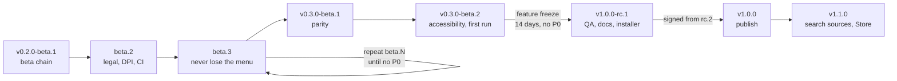

# Roadmap to 1.0

The plan from the current alphas to a published v1.0.0, as of 2026-11-06. The [project board](https://github.com/users/jav76/projects/3) is the source of truth for status. This page records the order, the gates and the reasons. `#N` is an issue or pull request. `Fxx` is an entry in the [feature catalog](feature-catalog.md) that is not filed as an issue yet.

## Where things stand

- Three unsigned alphas are out (v0.1.0-alpha.1, v0.1.1-alpha.1 and v0.1.2-alpha.1): Windows x64 and arm64 `.zip`, Linux amd64 and arm64 `.deb` and `.tar.gz`. The first two report version 0.1.0 to Cargo and apt, so apt never upgraded between them; v0.1.2-alpha.1 is the first whose package version (0.1.2~alpha.1-1) sorts above them.
- v0.1.2-alpha.1 ships the App Action Flyout (#21) and the six stacked PRs (#22-#27): a log file and panic reports, `--version`/`--help`/`toggle`/`quit`, safer config and usage saves, a snapshot authorization audit, and a prerelease flow with checksums and a changelog. v0.2.0-beta.1 still waits on the Slint attribution, tag gating and the hand checks on #28.
- Windows code is linted by cross-target clippy, but its tests and the shipped `.exe` never run in CI.
- Shipped archives carry no third-party license notices, and the Slint royalty-free attribution is missing (the license asks for `AboutSlint` in an About screen or the Made with Slint badge on the download page).
- Several paths leave users with no working Win or Meta key: Windows removing the hook after a stall, Explorer or kglobalacceld restarting, and quitting or upgrading the host on Plasma.

## Ground rules

- The host makes no network calls. Updates arrive through package managers, and the Web Fallback opens the browser.
- Every milestone keeps the AGENTS.md budgets: first frame at or under 75 ms after the trigger, each search frame within 16 ms, and a row rebuild under 1 ms at 1,000 apps.
- Fail open: when Rusty Start cannot draw, the native Start menu or Kickoff opens instead (F99).
- One Linux binary probes each capability at runtime.
- The release candidate is a feature freeze. After v0.3.0-beta.2, only P0 and P1 fixes and regressions merge.
- Severity: P0 blocks an RC (dead trigger, data loss, crash loop, security, legal), P1 is expected by most users before 1.0, P2 is valuable and P3 is nice to have.

## Milestones at a glance

| Milestone | Focus | Leaves when |
| :--- | :--- | :--- |
| v0.2.0-beta.1 | Beta chain | Prerelease with SHA256SUMS; Slint badge; tags gated on green CI |
| v0.2.0-beta.2 | Legal, DPI and release process | Notices in every artifact; Windows tests run in CI; signing identity submitted |
| v0.2.0-beta.3 | Never lose the menu | No open P0; Win and Meta survive sleep, restarts, quit and crashes |
| v0.3.0-beta.1 | Daily-driver parity | Settings search, Web Fallback, hidden apps, upgrade fixtures; budgets hold |
| v0.3.0-beta.2 | Accessible, first run, freeze-ready | Screen readers, contrast, reduced motion, first run; feature freeze declared |
| v1.0.0-rc.1 | Release candidate | Tier 1 QA matrix passes; attested artifacts; NSIS installer; 5+ testers |
| v1.0.0 | Signed 1.0 and publication | Signed from rc.2; winget, Scoop, apt repo and AUR live |
| v1.1.0 | Search sources, personalization and the Store | File and fuzzy search, paid Store MSIX, RPM and COPR |
| Later | Demand-driven backlog | Re-triaged against user requests |

## Milestone details

### v0.2.0-beta.1: Beta chain

Merge PRs [#21](https://github.com/jav76/rusty-start/issues/21)-[#27](https://github.com/jav76/rusty-start/issues/27) in order and publish the first beta, with the Slint attribution fixed and tags gated on green CI.

**Starts when**

- PRs [#21](https://github.com/jav76/rusty-start/issues/21)-[#27](https://github.com/jav76/rusty-start/issues/27) open; each green on cargo clippy --workspace --all-targets --locked -- -D warnings and cargo test --workspace --locked
- [PR #21](https://github.com/jav76/rusty-start/pull/21) rebased onto the chain with its 8 eprintln! calls converted (F97)

**Done when**

- [ ] gh pr list --state open shows none of [#21](https://github.com/jav76/rusty-start/issues/21)-[#27](https://github.com/jav76/rusty-start/issues/27); merge order was [#21](https://github.com/jav76/rusty-start/issues/21) then [#22](https://github.com/jav76/rusty-start/issues/22)..[#27](https://github.com/jav76/rusty-start/issues/27)
- [ ] v0.2.0-beta.1 is a GitHub prerelease; sha256sum -c SHA256SUMS passes on the downloaded assets
- [ ] dpkg-deb -f on the amd64 .deb prints Version 0.2.0~beta.1-1
- [ ] README shows the official Made with Slint badge and the correct Slint license name
- [ ] Main ruleset requires the 'fmt, clippy, test' check; a refs/tags/v* ruleset exists; fork PR approval is set for all outside contributors
- [ ] The 'Not yet checked by hand' steps from PRs [#21](https://github.com/jav76/rusty-start/issues/21)-[#26](https://github.com/jav76/rusty-start/issues/26) are run on Windows 11 and Plasma 6, with results recorded on [#28](https://github.com/jav76/rusty-start/issues/28)

| Ref | Work | Why in this milestone |
| :--- | :--- | :--- |
| [#10](https://github.com/jav76/rusty-start/issues/10) | App Action Flyout ([PR #21](https://github.com/jav76/rusty-start/pull/21)) | Merge first: [PR #27](https://github.com/jav76/rusty-start/pull/27)'s changelog lists it under 0.2.0-beta.1 |
| F97 | Reconcile [PR #21](https://github.com/jav76/rusty-start/pull/21) with the logging lint | [PR #22](https://github.com/jav76/rusty-start/pull/22) makes print_stderr an error; whichever PR merges second fails clippy |
| [PR #22](https://github.com/jav76/rusty-start/pull/22) | Rotating log file and panic reports | Chain order; F52 extends it later |
| [PR #23](https://github.com/jav76/rusty-start/pull/23) | Reset the Windows-key chord after a lost key-up | Chain order; its chord module later hosts F23 |
| [PR #24](https://github.com/jav76/rusty-start/pull/24) | --version, --help, toggle and quit | Chain order; F21 must later make Quit hand Meta back |
| [PR #25](https://github.com/jav76/rusty-start/pull/25) | Keep damaged files and flush saves at sign-out | Before merging: move the WM_QUERYENDSESSION flush off the hook thread, and treat a newer usage.tsv version as read-only for the session |
| [PR #26](https://github.com/jav76/rusty-start/pull/26) | Remove stale dev entries and audit snapshot authorization | Chain order |
| [PR #27](https://github.com/jav76/rusty-start/pull/27) | Prerelease publishing with checksums and changelog | Carries F79's main-ancestor and green-CI check |
| F79 | Gate releases on green CI and protect tags | The first tag made with the new flow should already be gated |
| F86 | Slint royalty-free attribution | Doc-only change; every build already shipped is affected |

**Ships**

- GitHub Releases prerelease: Windows x64/arm64 zip, Linux amd64/arm64 .deb and tar.gz, SHA256SUMS, CHANGELOG (unsigned)
- Pin a beta feedback issue

### v0.2.0-beta.2: Legal, DPI and release process

Fix what every download already owes and what every high-DPI Windows user sees, stop upgrades breaking autostart, and start the calendar-bound work: Windows CI and the signing identity.

**Starts when**

- v0.2.0-beta.1 published
- Milestones v0.2.0-beta.2 through v1.0.0 created (first task of F84)

**Done when**

- [ ] unzip -l, tar tf and dpkg -c each list THIRD-PARTY-NOTICES; CI fails when it is stale
- [ ] Task Manager's DPI awareness column shows Per-monitor (v2) for rusty-start.exe on a 150% display, and the startup log line agrees
- [ ] unzip -l shows a top folder of 'Rusty Start/' with no version in it
- [ ] Tab and Shift+Tab in the search field never drop typed characters (manual check, both OSes)
- [ ] The language_list_is_preferred_over_lang test passes
- [ ] A native Windows job (or the documented wine interim) runs cargo test --workspace --locked and is green
- [ ] RELEASING.md has the RC exit criteria and severity definitions; every open issue has a milestone
- [ ] SECURITY.md is present and private vulnerability reporting is on
- [ ] ADR 0008 is merged and signing identity validation has been submitted

| Ref | Work | Why in this milestone |
| :--- | :--- | :--- |
| F85 | Third-party license notices | P0 legal debt on every archive shipped so far |
| F48 | Embedded manifest with per-monitor DPI awareness | P0; [#32](https://github.com/jav76/rusty-start/issues/32) and F64 build on it |
| F61 | Version-free folder inside the zip | Every beta-to-beta upgrade breaks the Run value today |
| F30 | Tab focus and keyboard-reachable buttons | S fix for dropped keystrokes |
| F37 | Honor LANGUAGE for app names | S, pure fix |
| F77 | Windows tests and smoke check in CI | P0; resolving the Actions billing block is calendar-bound |
| F84 | Release procedure, milestones, exit criteria, severity | Nothing else can be scheduled without it |
| F88 | Community health files and repo metadata | Beta testers need bug and security channels |
| F90 | Distribution and signing ADR | The signing identity has 1-20 business days of lead time |
| F91 | Fix the Sponsors link and support wording | The link is broken today |

**Ships**

- GitHub Releases prerelease, now with notices
- Signing identity validation submitted (Artifact Signing or Certum)

### v0.2.0-beta.3: Never lose the menu

Close every dead-trigger, crash and focus failure on both platforms, finish the [#28](https://github.com/jav76/rusty-start/issues/28) fixes, make crashes diagnosable, and isolate release builds before any release secret exists. Repeat beta.N until there are no open P0s.

**Starts when**

- v0.2.0-beta.2 published and Windows CI green
- [#37](https://github.com/jav76/rusty-start/issues/37) ADR drafted

**Done when**

- [ ] gh issue list --milestone v0.2.0-beta.3 --label P0 is empty
- [ ] Manual, Windows: Win opens Rusty Start after sleep and resume, Win+L and unlock, a cancelled shutdown, and an Explorer kill and restart
- [ ] Manual, Plasma: after rusty-start quit, Meta opens Kickoff; after kill -9 the host restarts; Meta works after kglobalacceld restarts
- [ ] With a simulated hung UI thread or no GL, Win opens the native Start menu (fail open)
- [ ] rusty-start --version prints version, commit and target; a forced panic logs a backtrace
- [ ] lintian --fail-on warning is clean on both .debs
- [ ] release.yml runs only on an ephemeral release-labelled runner behind a protected environment

| Ref | Work | Why in this milestone |
| :--- | :--- | :--- |
| [#29](https://github.com/jav76/rusty-start/issues/29) | Terminal=true launches on non-Debian distros | AUR (rc.1) depends on it |
| [#30](https://github.com/jav76/rusty-start/issues/30) | Watch new app folders; guard against symlink loops | A symlink loop can hang startup |
| [#31](https://github.com/jav76/rusty-start/issues/31) | Show launch failures; record only successes | F51 builds on its notice slot |
| [#32](https://github.com/jav76/rusty-start/issues/32) | Clamp the card; re-lay-out on scale change | Needs F48 from beta.2 |
| [#33](https://github.com/jav76/rusty-start/issues/33) | Survive an Explorer restart | P0 dead trigger |
| [#34](https://github.com/jav76/rusty-start/issues/34) | Windows power edge cases plus admin policies (F17) | One pure decision function |
| [#37](https://github.com/jav76/rusty-start/issues/37) | Software renderer decision | Gates F99 and the GUI smoke test |
| [#38](https://github.com/jav76/rusty-start/issues/38) | Complete .deb metadata | Lintian-clean before the apt repo; needs F64 icon |
| [#39](https://github.com/jav76/rusty-start/issues/39) | Keep the tarball with templated paths | AUR and nixpkgs depend on it |
| F20 | Reinstall the Windows-key hook | P0 silent dead trigger |
| F21 | Meta works when the host is not running | P0: quit, crash, upgrade and remove leave Meta dead |
| F93 | Re-register after kglobalacceld restarts | P0 dead trigger, Linux counterpart of [#33](https://github.com/jav76/rusty-start/issues/33) |
| F99 | Fail open to the native menu | P0: a hung UI or missing GL means no Start menu at all |
| F50 | Restart after crashes | Resident process with no supervisor |
| F100 | Crash-loop guard and post-crash notice | Completes the crash story |
| F22 | Never leave the menu open without focus | Typing goes to the window behind |
| F23 | Accept injected Windows-key taps | Remapper and KVM users get the native menu today |
| F24 | Ctrl+Esc and a configurable hotkey | Trigger code and a config key the freeze will lock |
| F25 | Elevated windows: verify, document, warn | Trigger behavior to document before the RC |
| F28 | Detect when the native Start opens anyway | Only early warning without Windows CI coverage |
| F56 | Non-Plasma setup steps; detect Plasma by capability | Same setup and trigger code as F21; fixes an AGENTS violation |
| F52 | Startup header, backtraces, symbols, log location | Beta crash reports must be actionable |
| F53 | Diagnostics report and log folder button | The bug form asks for it |
| F64 | Icon, VERSIONINFO and branding | Prerequisite for [#38](https://github.com/jav76/rusty-start/issues/38), the installer and signing |
| F110 | Trademark and affiliation review | Before the icon is final |
| F80 | Isolate release builds from PR code | P0; must precede every release secret |
| F94 | Config format ADR | The feature betas add keys |
| F95 | Flush config on Linux SIGTERM | Closes [PR #25](https://github.com/jav76/rusty-start/pull/25)'s data-loss story |
| F103 | Move Windows decision logic into cfg-free modules | Gives [#34](https://github.com/jav76/rusty-start/issues/34), F23, F24 and F12 Linux-CI tests |

**Ships**

- GitHub Releases prerelease built on the isolated release runner

### v0.3.0-beta.1: Daily-driver parity

Finish the [#6](https://github.com/jav76/rusty-start/issues/6) parity scope for 1.0, make launched apps come to the front, add the app management users expect, and let upgrades take over the running host.

**Starts when**

- v0.2.0-beta.3 exit criteria met
- F94 config ADR merged

**Done when**

- [ ] cargo test -p rusty-start-host --profile budget --locked -- --ignored passes with folded and keyword queries added
- [ ] 'parametres' finds Parametres/Paramètres and 'bluetooth' finds the settings page (manual, both OSes)
- [ ] RUSTY_START_TRACE_OPEN: first frame at or under 75 ms and search frames within 16 ms on the 3440x1440 Plasma desktop, stated in each affected PR
- [ ] A cold launch and Ctrl+Shift+Enter on cmd open in front (manual)
- [ ] Running a newer exe or package replaces the older host (manual, both OSes)
- [ ] Fixture tests load files written by 0.1.0-alpha.1, 0.1.1-alpha.1 and 0.2.0-beta.1, and unknown usage records survive a save

| Ref | Work | Why in this milestone |
| :--- | :--- | :--- |
| [#11](https://github.com/jav76/rusty-start/issues/11) | Reorder pinned apps | Needs [#10](https://github.com/jav76/rusty-start/issues/10) |
| [#12](https://github.com/jav76/rusty-start/issues/12) | Search settings pages | In for 1.0: 'display' must reach Settings |
| [#13](https://github.com/jav76/rusty-start/issues/13) | Opt-in Web Fallback | In for 1.0; S, and opt-in |
| F01 | Diacritic folding | P1 for non-English users |
| F03 | Linux program-name keywords | Load-time only |
| F45 | Rank non-program shortcuts lower | Cheap clutter fix |
| F42 | Hide apps | P1 control; new usage record type |
| F43 | Launch history controls | The privacy statement depends on it |
| F44 | Choose what the empty menu shows | Backs the charter |
| F55 | 1.0 compatibility contract and upgrade fixtures | P0; code lands with beta soak, the document is final at rc.1 |
| F11 | Hand the foreground to launched apps and UAC | Core launch defect |
| F12 | Refresh the environment after PATH changes | Developer parity |
| F13 | Outbound xdg-activation tokens | Linux counterpart of F11 |
| F14 | Flyout actions from shell properties | [PR #21](https://github.com/jav76/rusty-start/pull/21) follow-up |
| F18 | Update and shut down; Hibernate | Extends [#34](https://github.com/jav76/rusty-start/issues/34)'s function |
| F62 | Replace an older running host | Upgrade correctness; new protocol message |
| F63 | Upgrade and uninstall steps | Needs F21 |
| F72 | Release notes link and Updating docs | Host code before the freeze |

**Ships**

- GitHub Releases prerelease; recruit testers (F112) from here

### v0.3.0-beta.2: Accessible, first run, freeze-ready

Last feature beta. Make the menu usable by keyboard, screen reader, touch and over light wallpapers, give new users a first run, show failures in the card, and settle the remaining keys and support statements the RC freezes.

**Starts when**

- v0.3.0-beta.1 published with no open P0

**Done when**

- [ ] Narrator and Orca announce the selected row and its position (manual)
- [ ] The contrast helper test holds 4.5:1 for primary text over white; before/after screenshots attached
- [ ] On a fresh profile, first run opens the welcome and asks consent before enabling use_win_key
- [ ] With reduced motion on, the menu opens with an opacity-only ramp; first-frame numbers stated
- [ ] Feature freeze declared: after this tag, no feat PRs merge into crates/ without an approved exception

| Ref | Work | Why in this milestone |
| :--- | :--- | :--- |
| [#16](https://github.com/jav76/rusty-start/issues/16) | Theme tokens shared with the glass | F32 and F34 build on it |
| [#36](https://github.com/jav76/rusty-start/issues/36) | Keyboard polish | Pairs with F31 |
| F31 | Screen reader support | Needed for a 1.0 accessibility claim |
| F32 | Clamp card luminance | Readability bug |
| F33 | Reduced motion | Host code before the freeze |
| F34 | Opaque card for contrast and transparency off | Respects OS settings |
| F38 | Touch pin hit-target fix | A tap pins instead of launching |
| F40 | First run welcome and consent | P1 first impression |
| F41 | Keyboard shortcut list | Delivered with F40 |
| F49 | Icons at monitor scale | Pairs with [#32](https://github.com/jav76/rusty-start/issues/32) |
| F51 | Empty, loading and failure states | Needs [#31](https://github.com/jav76/rusty-start/issues/31) and [#13](https://github.com/jav76/rusty-start/issues/13) |
| F27 | Plain Glass when the snapshot is black | Bug for full-screen games, verify first |
| F58 | State Plasma X11 support | F92 needs it |
| F114 | Detect conflicting Start replacements | Setup Audit row |

**Ships**

- GitHub Releases prerelease; matrix dry run (F78 draft)

### v1.0.0-rc.1: Release candidate

Feature freeze. Ship the first RC with the installer, verified and attested artifacts, the Tier 1 QA matrix passed, and the privacy, support, troubleshooting and reference docs. After this tag only P0/P1 fixes and regressions merge.

**Starts when**

- v0.3.0-beta.2 out for at least 14 days with no open P0 and no data-loss or dead-trigger report
- Every 1.0 host feature merged; the in-or-out calls are recorded in the milestone description

**Done when**

- [ ] Every rc_checklist row is checked
- [ ] QA matrix Tier 1 rows pass on the draft rc.1 artifacts and an RC sign-off issue is filed
- [ ] The verify job is green and gh attestation verify passes for every asset
- [ ] cargo deny check and cargo +1.92 check --workspace --locked pass
- [ ] The NSIS installer installs, upgrades from the zip and uninstalls cleanly on Windows 11 x64
- [ ] makepkg builds and installs rusty-start-bin
- [ ] At least 5 external testers have confirmed Tier 1 configurations

| Ref | Work | Why in this milestone |
| :--- | :--- | :--- |
| F67 | Per-user NSIS installer | Must be QA'd in an RC; signed from rc.2 |
| F65 | AUR packages | Low cost; recruits Arch testers |
| F81 | Smoke-test every artifact | Before immutable releases |
| F82 | Attestations, immutable releases, SBOM | Trustworthy RC |
| F83 | cargo-deny, Dependabot, MSRV job | Needs F80 |
| F107 | Release secrets management | Before AUR and signing keys |
| F78 | Manual QA matrix and RC sign-off | P0 RC gate |
| F92 | Support policy | Defines the QA tiers |
| F104 | Soak and leak test | RC gate |
| F105 | Property tests; no panics on the hook path | A parser panic is a dead trigger |
| F106 | Channel coexistence and migration | Users will switch channels |
| F109 | IPC and log security review | Feeds SECURITY.md |
| F112 | Recruit RC testers | The maintainer's machines alone are not enough |
| F54 | Idle footprint budget | Numbers recorded per RC |
| F87 | Privacy statement and charter | Promises only what 1.0 does |
| F89 | Troubleshooting guide | RC testers are its first readers |
| F96 | Docs audit | Catch the remaining wrong claims |
| F113 | Config, CLI and limitations reference | Documents the frozen contract |
| F101 | Linux GUI smoke on virtual KWin | Catches blank-window regressions |

**Ships**

- GitHub Releases prerelease with the unsigned NSIS installer, attestations and SBOM; immutable releases on
- AUR rusty-start-bin (RCs optional under an rc pkgver)

### v1.0.0: Signed 1.0 and publication

Turn on signing from rc.2, stand up the package channels during the RC window, and publish 1.0. Between rc.N and the tag, only P0/P1 fixes merge.

**Starts when**

- rc.1 published
- Signing identity validated

**Done when**

- [ ] osslsigncode verify shows a valid signature and timestamp on rusty-start.exe and the installer from rc.2 onward
- [ ] The last RC passed the matrix and went 14 days with no new P0/P1
- [ ] Defender (MpCmdRun) scan is clean and the VirusTotal result reviewed
- [ ] v1.0.0 is an immutable release
- [ ] winget install jav76.RustyStart works
- [ ] apt install rusty-start from the Cloudsmith repo works on Debian 13 and Kubuntu 26.04
- [ ] The AUR and the Scoop bucket are updated to 1.0.0

| Ref | Work | Why in this milestone |
| :--- | :--- | :--- |
| F66 | Code-sign Windows binaries | P0: Smart App Control blocks unsigned binaries |
| F68 | winget | Stable versions only |
| F69 | apt repository | A testing suite exercises rc.N upgrades |
| F71 | Scoop bucket | Cheap; generated by release.yml |
| F108 | Antivirus false-positive process | winget validation runs Defender |
| F102 | Windows UI smoke via UI Automation | CI only; no host change |
| F111 | Monthly Windows compatibility check | Process begins at 1.0 |
| F115 | Release runner continuity | A dead runner must not block 1.0.x fixes |

**Ships**

- Signed GitHub Release (zip, NSIS installer, .deb, tar.gz, SHA256SUMS, attestations, SBOM, notices)
- winget, Scoop own bucket, Cloudsmith apt stable, AUR

### v1.1.0: Search sources, personalization and the Store

First post-1.0 release: the async search lane and file index, fuzzy search, aliases and commands, size and translations, the paid Store build, and RPM/COPR.

**Starts when**

- v1.0.0 published
- F94 config ADR in effect for new tables

**Done when**

- [ ] Budget test passes with fuzzy and file-result queries
- [ ] The Store MSIX passes certification
- [ ] dnf copr enable jav76/rusty-start installs on Fedora KDE

| Ref | Work | Why in this milestone |
| :--- | :--- | :--- |
| [#14](https://github.com/jav76/rusty-start/issues/14) | Async search lane with recent files | Out of 1.0 by the in-or-out call |
| [#15](https://github.com/jav76/rusty-start/issues/15) | Index file names | Depends on [#14](https://github.com/jav76/rusty-start/issues/14) |
| [#35](https://github.com/jav76/rusty-start/issues/35) | Refresh changed icons | Needs change notification work |
| F02 | Typo-tolerant tier | A ranking change needs soak |
| F04 | Query picks and aliases | Safe after F55 |
| F05 | Known folders as results | Second sync source |
| F08 | User-defined commands | Needs F94 |
| F15 | Linux Manage via software center | New parity |
| F16 | Discrete GPU launches | New parity |
| F35 | Follow system text scale | Large layout change |
| F36 | Translatable UI | Ships with the first translation |
| F47 | Import pins | Needs [#11](https://github.com/jav76/rusty-start/issues/11) |
| F70 | RPM | Ships with COPR |
| F73 | MSIX packaged mode | Store prerequisite |
| F74 | Microsoft Store build | Paid convenience build |
| F98 | Persist rendered icons | First open after sign-in |
| F116 | Ignore Win in full-screen apps | Split from F27 |
| F117 | Press-to-record shortcut field | Split from F24 |
| F118 | Contrast-theme system colors | Split from F34 |
| F119 | Touch long press | Split from F38 |
| F120 | Glass tooltips | Split from F41 |
| F121 | All apps folder rows | Split from F45 |
| F122 | GPU context loss recovery | Split from F50 |

**Ships**

- Microsoft Store MSIX (paid)
- RPM plus Fedora COPR
- Scoop Extras request once 100 stars or 50 forks

### Later (unscheduled)

Backlog to pull from by demand once 1.1 ships.

**Starts when**

- v1.1.0 published

**Done when**

- [ ] Each item is re-triaged against user requests before it is scheduled

| Ref | Work | Why in this milestone |
| :--- | :--- | :--- |
| F06 | Calculator | Deferred in [#6](https://github.com/jav76/rusty-start/issues/6) |
| F07 | Run command | Deferred in [#6](https://github.com/jav76/rusty-start/issues/6); needs [#14](https://github.com/jav76/rusty-start/issues/14) |
| F09 | Window switching | L; needs [#14](https://github.com/jav76/rusty-start/issues/14) |
| F10 | Everything integration | Needs [#14](https://github.com/jav76/rusty-start/issues/14), [#15](https://github.com/jav76/rusty-start/issues/15) |
| F19 | Per-app recent documents | Jump lists deferred |
| F26 | uiAccess or elevated start | Needs signing and per-machine install |
| F39 | Alt+digit launch | P3 |
| F46 | Letter headers | P3 |
| F57 | GNOME icon theme | GNOME unsupported |
| F59 | Plasma panel widget | New surface |
| F60 | Layer shell and wlroots capture | XL |
| F75 | Vendored source tarball | Community packagers |
| F76 | Protocol crate on crates.io | When a toggler needs it |
| F123 | More power actions | Split from F18 |
| F124 | Deterministic archives and cosign | Split from F82 |

**Ships**

- crates.io protocol crate, community packaging (nixpkgs, OBS, PPA)

## Cutting a release

Once #27 merges, every release follows the same steps. `RELEASING.md` (F84) will hold the full procedure, including withdrawals and hotfixes.

1. Set `version` in the root `Cargo.toml` (for example `1.0.0-rc.1`) and add a `## [1.0.0-rc.1]` section to `CHANGELOG.md`. CI fails when the section is missing.
2. Merge to `main` with CI green.
3. Tag the merge commit `v<version>` and push the tag. The `create` job checks that the tag matches the Cargo version and opens one draft release, marked as a prerelease when the tag contains `-`.
4. The Linux and Windows jobs upload into the draft. The `publish` job adds `SHA256SUMS` and publishes it.
5. From rc.1, a verify job smoke-tests every artifact and attestations and an SBOM are attached before publishing (F81, F82). From rc.2, Windows binaries and the installer are signed (F66).
6. After publishing: stable tags update winget, Scoop, the apt repository and the AUR. Pin a known-issues issue for the release.

Prerelease versions sort correctly everywhere: tag `v0.2.0-beta.1` builds `.deb` version `0.2.0~beta.1-1`, which apt orders above `0.1.0-1` and below `0.2.0-1`. After 1.0, fixes go to a `release/1.0` branch and ship as 1.0.N.

## Publishing plan

| Channel | Platform | Starts | Cost | Blocked by |
| :--- | :--- | :--- | :--- | :--- |
| GitHub Releases (zip, .deb, tar.gz, SHA256SUMS) | Both | v0.2.0-beta.1 onward (canonical) | Free | Unsigned until F66; Windows binaries untested until F77 |
| Windows code signing (Azure Artifact Signing, Certum fallback) | Windows | v1.0.0 (validation starts in beta.2, signing from rc.2) | USD 9.99/month (Artifact Signing) or from EUR 69 (Certum OSS card) | Artifact Signing is for US/Canada individuals only; Certum needs a hardware token on the runner host; SignPath is not eligible with self-hosted builds |
| Per-user NSIS installer | Windows | v1.0.0-rc.1 (unsigned), signed from rc.2 | Free | Needs F62 and F64 |
| winget | Windows | v1.0.0 | Free | Needs the signed installer; moderator review takes days |
| Scoop (own bucket) | Windows | v1.0.0; Extras after 100 stars or 50 forks | Free | Excavator needs a Windows runner, so release.yml updates the manifest instead |
| .deb on GitHub Releases | Linux | v0.2.0-beta.1 onward; [#38](https://github.com/jav76/rusty-start/issues/38) complete in beta.3 | Free | [#38](https://github.com/jav76/rusty-start/issues/38) |
| apt repository (Cloudsmith OSS) | Linux | v1.0.0 (testing suite during the RC window) | Free | Needs the protected release environment (F80) for the token |
| AUR (rusty-start-bin) | Linux | v1.0.0-rc.1 | Free | [#39](https://github.com/jav76/rusty-start/issues/39) tarball, [#29](https://github.com/jav76/rusty-start/issues/29) terminal fallback, F85 notices |
| Linux tar.gz | Linux | v0.2.0-beta.3 | Free | [#39](https://github.com/jav76/rusty-start/issues/39) |
| Microsoft Store MSIX (paid convenience build) | Windows | v1.1.0 | Free account; 15% commission | Packaged-mode code, policy 10.2.8 consent, MSIX build on Linux unverified |
| RPM plus Fedora COPR | Linux | v1.1.0 | Free | [#29](https://github.com/jav76/rusty-start/issues/29), [#39](https://github.com/jav76/rusty-start/issues/39) |
| crates.io and community packaging (nixpkgs, OBS, PPA) | Both | Later | Free | F55 stability promise |
| Not shipped: Flathub, Snap, AppImage, MSI/WiX, Chocolatey, KDE Store | Both | never (recorded in ADR 0008) | n/a | Sandboxing breaks KWin exe-path snapshot authorization, kglobalaccel and host launches; AppImage's mount path changes every run; WiX is Windows-only with a fee risk; Chocolatey moderates every version |
| GitHub Sponsors | n/a | v0.2.0-beta.2 | Free | No listing exists today |

Steps and sources per channel

**GitHub Releases (zip, .deb, tar.gz, SHA256SUMS)**

1. Use [PR #27](https://github.com/jav76/rusty-start/pull/27)'s draft flow with F79's green-CI and main-ancestor check
1. beta.2: add notices (F85) and the version-free zip folder (F61)
1. beta.3: build on the isolated release runner (F80)
1. rc.1: verify job (F81), attestations, immutable releases and SBOM (F82); release notes carry the Slint badge, toolchain versions and known issues

Sources: gh pr view 27; docs.github.com artifact attestations; github.blog immutable releases GA 2025-10-28

**Windows code signing (Azure Artifact Signing, Certum fallback)**

1. Pick the identity in ADR 0008
1. Submit identity validation (1-20 business days)
1. Add jsign 7.6 to the bookworm release container with an RFC 3161 timestamp
1. Sign the exe, then the installer and uninstaller
1. Verify with osslsigncode
1. Submit to Microsoft's false-positive portal per release

Sources: learn.microsoft.com artifact-signing quickstart and pricing; shop.certum.eu; ebourg.github.io/jsign; signpath.org/terms

**Per-user NSIS installer**

1. Run makensis from Debian nsis in the Windows release job
1. Install to %LOCALAPPDATA%\Programs\Rusty Start with an HKCU Uninstall entry and /S
1. Quit and relaunch around upgrades; setup --undo on uninstall
1. Create the Start Menu shortcut and exclude it from the index
1. Keep the zip for portable use

Sources: winget-cli#5235; NSIS docs

**winget**

1. Prepare the manifest with komac new during the RC window (nullsoft, x64 and arm64)
1. Submit at 1.0
1. Automate komac update --submit for tags without '-' using a classic PAT in the release environment
1. Add install and upgrade lines to the README

Sources: github.com/russellbanks/Komac; learn.microsoft.com winget repository docs

**Scoop (own bucket)**

1. Create the jav76/scoop-bucket repo
1. Generate rusty-start.json from release.yml
1. Document quitting the host before scoop update

Sources: ScoopInstaller BucketTemplate and Extras request template

**.deb on GitHub Releases**

1. Add libegl1 and libxkbcommon0 to depends
1. Add the postinst kbuildsycoca6, Icon=, AppStream metainfo and notices
1. Run lintian in the verify job

Sources: gh issue view 38; cargo-deb

**apt repository (Cloudsmith OSS)**

1. Create the Cloudsmith open-source repo
1. Push -beta/-rc tags to a testing suite and stable tags to stable
1. Publish a deb822 .sources file with Signed-By
1. Add the attribution line to the README

Sources: help.cloudsmith.io open-source hosting policy

**AUR (rusty-start-bin)**

1. Write a PKGBUILD from the release tarball (x86_64, aarch64)
1. Deploy with KSXGitHub/github-actions-deploy-aur pinned by SHA from the release environment
1. Add a post_install setup hint

Sources: wiki.archlinux.org AUR submission guidelines

**Linux tar.gz**

1. Keep shipping it with templated Exec paths ([#39](https://github.com/jav76/rusty-start/issues/39))
1. Document the /usr/bin install

Sources: release.yml:64-67

**Microsoft Store MSIX (paid convenience build)**

1. Implement packaged mode (F73)
1. Register a free individual Partner Center account and reserve the name
1. Add logos, screenshots, privacy URL and certification notes on the opt-in hook
1. Submit with the msstore CLI

Sources: Store policies 10.2.8, 10.5.1, 10.8.2; microsoft/msstore-cli

**RPM plus Fedora COPR**

1. Add generate-rpm metadata
1. Build x86_64 and aarch64
1. Create the COPR and trigger it on tags

Sources: crates.io cargo-generate-rpm; copr man page

**crates.io and community packaging (nixpkgs, OBS, PPA)**

1. Publish the protocol crate with trusted publishing
1. Attach a vendored source tarball for packagers

Sources: rust-lang/crates-io-auth-action; nixpkgs by-name README

**Not shipped: Flathub, Snap, AppImage, MSI/WiX, Chocolatey, KDE Store**

1. Document the reasons in ADR 0008 and the README

Sources: docs.flathub.org requirements; snapcraft classic review; docs.firegiant.com OSMF

**GitHub Sponsors**

1. Finish the profile (2FA, Stripe Connect, tax form, tiers), or remove the link and FUNDING.yml until approved

Sources: docs.github.com sponsors setup

## Release candidate checklist

Every row is checked on the draft RC artifacts and recorded in the RC sign-off issue.

**Code quality**

- [ ] Format and lints clean, including the preview feature and the Windows target. _How: cargo fmt --all -- --check; cargo clippy --workspace --all-targets --locked -- -D warnings; same with -p rusty-start-host --features preview; cargo clippy --target x86_64-pc-windows-msvc_
- [ ] Tests pass on Linux and natively on Windows x64 (arm64 if a runner exists). _How: cargo test --workspace --locked in the bookworm container and on the Windows job (F77)_
- [ ] Supply chain and MSRV. _How: cargo deny check (advisories, licenses, no HTTP/TLS crates); cargo +1.92 check --workspace --locked_
- [ ] No unwrap outside tests, no todo!/unimplemented!, property tests pass, every new backend API has a preview implementation. _How: rg checks in CI; proptest suite (F105); cargo run -p rusty-start-host --features preview_

**Performance**

- [ ] Row rebuild under 1 ms at 1,000 apps, including folded and keyword queries. _How: cargo test -p rusty-start-host --profile budget --locked -- --ignored_
- [ ] First visible frame at or under 75 ms after the trigger (100 ms hard limit) on the 3440x1440 Plasma desktop, plus a Windows 11 figure. _How: RUSTY_START_TRACE_OPEN numbers recorded in the RC sign-off issue_
- [ ] Each search frame within 16 ms of the keystroke. _How: RUSTY_START_TRACE_OPEN while typing a 10-character query_
- [ ] Idle footprint within the AGENTS.md budget; no growth over 1,000 toggles and 24 h resident. _How: F54 and F104 scripts; Task Manager or smaps for private bytes or RSS, GDI/USER handle counts, GPU memory_

**QA matrix**

- [ ] Windows 11 x64 24H2 and 25H2 Tier 1 rows pass. _How: docs/qa/matrix.md rows signed off on the draft RC artifacts_
- [ ] Windows on ARM with and without the OpenGL compatibility pack: menu renders or fails open to native Start. _How: Manual (Tier 2)_
- [ ] Plasma 6 Wayland on Debian 13 and Kubuntu 26.04: Meta, Fog Veil (not Plain Glass), launches, power, kglobalacceld restart. _How: Manual (Tier 1)_
- [ ] Two monitors with different scale factors: sharp card on the cursor's monitor; Task Manager shows Per-monitor (v2). _How: Manual, Windows and Plasma_
- [ ] RDP session or VM: the menu renders or fails open; the Start menu is never lost. _How: Manual_
- [ ] Trigger robustness: sleep and resume, lock and unlock, Explorer restart, cancelled shutdown, elevated window (documented behavior), On-Screen Keyboard Win, Ctrl+Esc, external toggle without focus rights. _How: Manual rows from F20, F22, F23, F24, F25, [#33](https://github.com/jav76/rusty-start/issues/33)_
- [ ] Accessibility: keyboard-only pass of every action, Narrator and Orca announcements, contrast over a white wallpaper, reduced motion, IME composition. _How: Manual; contrast helper unit test_

**Upgrade**

- [ ] Upgrade from 0.1.0-alpha.1, 0.1.1-alpha.1 and the latest beta keeps pins, history and settings, and autostart points at the new exe. _How: F55 fixture tests plus a manual zip to NSIS and .deb to apt upgrade_
- [ ] A newer binary takes over the running host; downgrading to the last beta does not move usage.tsv aside. _How: Manual (F62); fixture test for the newer-version read-only case_

**Uninstall**

- [ ] Windows: the NSIS uninstaller (or the documented zip steps) removes the Run value and Win opens the native Start. _How: Manual; reg query HKCU\...\Run_
- [ ] Linux: apt remove plus setup --undo returns Meta to Kickoff and leaves no live autostart entry. _How: Manual; ls ~/.config/autostart; kglobalaccel binding check_

**First run**

- [ ] Fresh profile opens the welcome, asks consent before taking the Windows key, and Setup Install works. _How: Manual on both OSes with config folders removed_

**Docs**

- [ ] README, GLOSSARY, ADRs, CHANGELOG, PRIVACY, SUPPORT, SECURITY, troubleshooting and the config/CLI reference match the RC. _How: F96 audit; reference drift unit test (F113); link check_

**Legal**

- [ ] THIRD-PARTY-NOTICES present and current in every artifact; Made with Slint badge on the README and release notes; LICENSE shipped; trademark review done. _How: unzip -l, tar tf, dpkg -c; CI staleness check_

**Release artifacts**

- [ ] Verify job green: .deb installs on trixie and ubuntu:24.04, --version matches the tag, lintian clean, arm64 runs under qemu, wine --version works, no VCRUNTIME140 or network imports, expected file lists. _How: F81 job in release.yml_
- [ ] SHA256SUMS, attestations and SBOM attached; toolchain versions in the notes; release immutable once published. _How: sha256sum -c; gh attestation verify <file> -R jav76/rusty-start_
- [ ] Windows binaries and installer signed and timestamped (rc.2 onward). _How: osslsigncode verify; Windows file properties_

**Security**

- [ ] Release runs on the isolated ephemeral runner with secrets in a protected environment; fork approval covers all outside contributors. _How: gh api environments and actions permissions; workflow run logs show the release label_

**Privacy**

- [ ] Logs contain no typed queries or key codes, and the host makes no network calls. _How: F109 test; cargo deny bans; PE import check_

**Release gate**

- [ ] No open P0; P1s triaged; known-issues issue pinned; at least 5 tester confirmations; Defender and VirusTotal reviewed. _How: gh issue list --label P0 --state open is empty; RC sign-off issue_

## Decisions to make

Each needs an answer before the milestone that depends on it. Recommendations are marked.

### 1. Which code-signing route will 1.0 use?

| Option | Pros | Cons | Design Considerations |
| :--- | :--- | :--- | :--- |
| **Azure Artifact Signing** | About USD 120/year; Microsoft-run; short-lived certificates; jsign works on Linux | US/Canada individuals only; 1-20 business days to validate; certificate shows name and city | OIDC credential in the protected release environment; reputation is tied to the identity |
| **Certum Open Source smart card** | From EUR 69; available outside the US and Canada | Hardware token attached to the runner host; renewal within 460 days | PKCS#11 through jsign with pcscd passed into the container; conflicts with ephemeral runners unless the token is passed through |
| **OV certificate with a CA cloud key** | No hardware; available anywhere | USD 150-300/year; 460-day maximum validity | Cloud key API through jsign |

**Recommendation:** Artifact Signing if the maintainer lives in the US or Canada, otherwise Certum OSS. Submit in beta.2 so rc.2 can be signed.

### 2. How does Windows code get tested in CI?

| Option | Pros | Cons | Design Considerations |
| :--- | :--- | :--- | :--- |
| **GitHub-hosted windows-2025 and windows-11-arm** | Free for public repos; native arm64; takes PR code off the self-hosted runner | The account billing lock must be cleared; basic display adapter only | GUI smoke waits on [#37](https://github.com/jav76/rusty-start/issues/37) |
| **Ephemeral self-hosted Windows 11 VM** | Independent of billing; a real GPU is possible | Licensing and maintenance; must run only on main and tags | KVM on the runner host |
| **cargo xwin test under wine (interim)** | No new infrastructure | COM, shell and hook behavior differ from Windows | Compile coverage only for Windows-only tests |

**Recommendation:** Hosted runners. Use wine only as a stopgap until the billing lock is cleared.

### 3. How does Meta keep working on Plasma when the host is not running (F21)?

| Option | Pros | Cons | Design Considerations |
| :--- | :--- | :--- | :--- |
| **Give Meta back on quit plus a systemd user unit with Restart=on-failure** | No per-tap cost; fast path unchanged | Does not help after apt remove without setup --undo | Unit name in crates/protocol; ADR amending 0005 |
| **Desktop-file kglobalaccel component** | Works whenever the package is installed, like Spectacle | Spawns a process and systemd scope on every tap, which threatens the 75 ms budget | [Desktop Action toggle] with X-KDE-Shortcuts |
| **Both** | Covers every case | Most complexity | Two code paths to test |

**Recommendation:** The first option now. Adopt the desktop-file component only if RUSTY_START_TRACE_OPEN shows tap-to-first-frame at or under 75 ms.

### 4. What is 1.0 search scope (#12-#15 and the #6 deferrals)?

| Option | Pros | Cons | Design Considerations |
| :--- | :--- | :--- | :--- |
| **#12 and #13 in; #14, #15 and deferrals in v1.1** | Small opt-in pieces; the freeze stays achievable | No file results at 1.0 | Async lane designed after 1.0 |
| **#12 only** | Smallest | No-results state lacks the Web Fallback | [#13](https://github.com/jav76/rusty-start/issues/13) moves to 1.1 |
| **#12-#15 all in** | Feature-complete search | Large new architecture without beta soak; 1.0 slips | New threads and file watchers before the freeze |

**Recommendation:** [#12](https://github.com/jav76/rusty-start/issues/12) and [#13](https://github.com/jav76/rusty-start/issues/13) in, [#14](https://github.com/jav76/rusty-start/issues/14) and [#15](https://github.com/jav76/rusty-start/issues/15) in v1.1. Fuzzy search (F02) also goes to 1.1.

### 5. Which Windows install format ships at 1.0?

| Option | Pros | Cons | Design Considerations |
| :--- | :--- | :--- | :--- |
| **Per-user NSIS installer plus portable zip** | Stable path, ARP entry, clean upgrades and uninstall, winget nullsoft type; builds on Linux | Another artifact to sign and QA | makensis plus jsign in release.yml |
| **Zip only (version-free folder)** | Simplest | winget portable upgrade bug with a locked exe; uninstall leaves the Run value | Users quit before upgrading |
| **MSI via WiX** | Enterprise friendly | Windows-only toolchain; possible maintenance fee once paid builds exist | Needs a Windows build host |

**Recommendation:** NSIS plus zip.

### 6. Which Linux channels ship at 1.0, and is Flatpak in?

| Option | Pros | Cons | Design Considerations |
| :--- | :--- | :--- | :--- |
| **.deb, Cloudsmith apt repo, AUR and tar.gz; RPM and COPR in 1.1** | Covers Tier 1 distros and Arch with real updates | Fedora users wait for 1.1 | One bookworm-built binary |
| **Same plus RPM at 1.0** | Fedora KDE at launch | No update path without COPR; more QA | cargo-generate-rpm |
| **Add Flathub** | Discoverability | Breaks KWin snapshot authorization, kglobalaccel and host launches; Flathub rejects system utilities | Sandbox escapes required |

**Recommendation:** The first option. Flatpak, Snap and AppImage never.

### 7. Should the Store build be paid or free?

| Option | Pros | Cons | Design Considerations |
| :--- | :--- | :--- | :--- |
| **Paid Store MSIX after 1.0; GitHub, winget and apt stay free** | Matches the README model; Store auto-update and Microsoft signing; funds maintenance | Packaged-mode work; certification risk on the hook | F73 and F74; decision recorded in ADR 0008 before 1.0 |
| **Free Store listing** | Discoverability; simpler policy review | No revenue | MSIX or the signed NSIS installer |
| **No Store** | No packaged-mode work | Drops the planned funding path | n/a |

**Recommendation:** A paid MSIX in v1.1, with free builds everywhere else.

### 8. How do users learn about updates without host network calls?

| Option | Pros | Cons | Design Considerations |
| :--- | :--- | :--- | :--- |
| **Package managers plus a Release notes link that opens the browser** | Keeps the [#6](https://github.com/jav76/rusty-start/issues/6) decision; no new code paths | Zip users must check by hand | F72; README Updating section |
| **Opt-in in-host update check** | Users get notified | Breaks the no-network promise, the cargo-deny bans and the privacy statement | An HTTP stack enters the binary |
| **Sideloaded MSIX .appinstaller** | The OS checks for updates | Needs packaged mode and a trusted signature | After F73 |

**Recommendation:** Package managers plus the Release notes link.

### 9. What happens when GL is unavailable (#37)?

| Option | Pros | Cons | Design Considerations |
| :--- | :--- | :--- | :--- |
| **Fail open to the native Start or Kickoff** | Small; never leaves users without a menu | No Rusty Start over RDP, in VMs or on Windows on ARM without GL | F99 heartbeat and renderer check |
| **Slint software renderer fallback** | Works everywhere as Plain Glass | New renderer path and slower frames | Glass disabled in that mode |
| **Bundle Mesa llvmpipe opengl32.dll** | Glass everywhere | Large binary; CPU rendering may miss the 100 ms cutoff | Windows only |

**Recommendation:** Fail open for 1.0; evaluate the software renderer for 1.1.

### 10. How does config.toml grow before the freeze (F94)?

| Option | Pros | Cons | Design Considerations |
| :--- | :--- | :--- | :--- |
| **Flat keys, file guaranteed valid TOML** | Keeps [PR #25](https://github.com/jav76/rusty-start/pull/25)'s tiny parser; a real parser can be added later without breaking files | Lists need another home | Lists live in usage.tsv records or separate files |
| **Adopt a TOML parser now** | Tables for aliases and commands | New dependency and parser change right before the freeze | toml with default features off |
| **Separate files per feature** | Isolated formats | More files to document and migrate | aliases.tsv, commands.toml |

**Recommendation:** Flat keys with the valid-TOML guarantee.

## Risks

| Risk | Impact | Mitigation |
| :--- | :--- | :--- |
| One maintainer facing about 80 pre-1.0 items | The RC slips by months | beta.N increments; P0 first. If late, cut in this order: F28, F33, F12, F14, F03, F45, F49, F27, F38. The rc.1 entry requires 14 days with no P0. |
| No Windows CI while most users run Windows | Windows-only bugs ship | F77 in beta.2, F103 cfg-free tests, the F78 matrix, F102 UIA smoke |
| A Windows update breaks Start suppression (undocumented behavior) | Two menus, or a dead key | F28 detection, F99 fail open, F111 monthly checks |
| Antivirus or SmartScreen flags the hook plus SendInput plus Run key as a keylogger | Quarantines; winget validation fails | F66 signing, F108 false-positive process, F87 privacy statement, F109 log rules |
| Signing identity validation is delayed or the maintainer is ineligible | 1.0 ships unsigned or late | Submit in beta.2; Certum OSS fallback |
| Outside PR code runs on the release runner | Compromised binaries | F79 approval setting at beta.1, F80 isolation, F107 secrets management |
| Slint attribution and notices missing from shipped builds | License breach for every download | F86 in beta.1, F85 in beta.2 |
| Compatibility freeze mistakes in config, usage or protocol | Data loss or broken toggle scripts after 1.x | F94, F55 fixtures, unknown records preserved, F113 drift test |
| Plasma changes to kglobalaccel or KWin ScreenShot2 authorization | Dead Meta or Plain Glass | F93, F21, F101 virtual KWin smoke, Tier 1 QA on two distros |
| The hosted Actions billing lock persists | No native Windows tests | Ephemeral Windows VM or wine interim |
| Too few testers (1 star) | RC bugs found after 1.0 | F112 recruiting from the feature betas; pinned feedback channel |
| New features regress latency | Loses the core promise | Budget test, RUSTY_START_TRACE_OPEN numbers required in PRs, F54 idle budget |

## Changes to existing issues and pull requests

Apply these when the milestones are created on GitHub.

| Ref | Change |
| :--- | :--- |
| [#6](https://github.com/jav76/rusty-start/issues/6) | Record the 1.0 in-or-out calls. In: [#10](https://github.com/jav76/rusty-start/issues/10)-[#13](https://github.com/jav76/rusty-start/issues/13) and [#16](https://github.com/jav76/rusty-start/issues/16). Out: [#14](https://github.com/jav76/rusty-start/issues/14) and [#15](https://github.com/jav76/rusty-start/issues/15) move to a v1.1 search-sources epic, and calculator, run command, jump lists, dragging pins, packaged-app keywords, file contents search, light mode and a monitor setting stay deferred. F118 is recorded as an accessibility exception to the light-mode deferral. Lift the distribution hold per ADR 0008 (signing, NSIS, winget, Scoop, apt, AUR for 1.0). Close the epic when [#10](https://github.com/jav76/rusty-start/issues/10)-[#13](https://github.com/jav76/rusty-start/issues/13) and [#16](https://github.com/jav76/rusty-start/issues/16) merge. |
| [#10](https://github.com/jav76/rusty-start/issues/10) / [PR #21](https://github.com/jav76/rusty-start/pull/21) | Milestone v0.2.0-beta.1, merged first. Rebase onto the chain and convert its eprintln! calls (F97). Follow-ups: F11, F14, F42, F43 (v0.3.0-beta.1), F38 (v0.3.0-beta.2), F15 (v1.1). |
| [#11](https://github.com/jav76/rusty-start/issues/11) | Milestone v0.3.0-beta.1. F47 (v1.1) imports pins in order. |
| [#12](https://github.com/jav76/rusty-start/issues/12) | Milestone v0.3.0-beta.1; in for 1.0. F05 follows the same sync-source pattern in v1.1. |
| [#13](https://github.com/jav76/rusty-start/issues/13) | Milestone v0.3.0-beta.1; in for 1.0. Its row appears in the F51 no-results state; F87 says the browser, not the host, makes the request. |
| [#14](https://github.com/jav76/rusty-start/issues/14) | Move to v1.1. Honor Start_TrackDocs and Plasma's recent-files setting (verify both). The lane later serves F07, F09, F10 and F19. |
| [#15](https://github.com/jav76/rusty-start/issues/15) | Move to v1.1 after [#14](https://github.com/jav76/rusty-start/issues/14); F05 shares the folder list. |
| [#16](https://github.com/jav76/rusty-start/issues/16) | Milestone v0.3.0-beta.2. Scope: opaque tokens for hint, placeholder and detail text, a CPU contrast helper (F32), and an opaque-card mode (F34). Following the system accent may split into a v1.1 issue if late. |
| [#28](https://github.com/jav76/rusty-start/issues/28) | Retarget: [#29](https://github.com/jav76/rusty-start/issues/29)-[#34](https://github.com/jav76/rusty-start/issues/34) and [#37](https://github.com/jav76/rusty-start/issues/37)-[#39](https://github.com/jav76/rusty-start/issues/39) to v0.2.0-beta.3, [#36](https://github.com/jav76/rusty-start/issues/36) to v0.3.0-beta.2, [#35](https://github.com/jav76/rusty-start/issues/35) to v1.1. Add F20, F21, F93 and F99 as P0 children. |
| [#29](https://github.com/jav76/rusty-start/issues/29) | Milestone v0.2.0-beta.3. Gates AUR (F65) and RPM (F70). |
| [#30](https://github.com/jav76/rusty-start/issues/30) | Milestone v0.2.0-beta.3. Watch recursively (Wine nests desktop files two or more levels deep), add a watch on IN_CREATE\|IN_ISDIR, rescan after the files land, and share the visited set with the symlink-loop guard. |
| [#31](https://github.com/jav76/rusty-start/issues/31) | Milestone v0.2.0-beta.3. One notice component and one live-region announcement shared with F51 and F31. |
| [#32](https://github.com/jav76/rusty-start/issues/32) | Milestone v0.2.0-beta.3, after F48 (beta.2). F49 re-renders icons on scale change and F35 reuses the clamp. |
| [#33](https://github.com/jav76/rusty-start/issues/33) | Milestone v0.2.0-beta.3, P0. After TaskbarCreated, also re-check the hook (F20) and the mask detection (F28). |
| [#34](https://github.com/jav76/rusty-start/issues/34) | Milestone v0.2.0-beta.3. Absorbs F17: one pure decision function (admin policies NoClose, NoLogoff, DisableLockWorkstation, HidePowerOptions, plus capabilities and refusals in; action list out), moved into a cfg-free module by F103. Policies are read at startup and on WM_SETTINGCHANGE on a worker thread. F18 adds the update-pending variants in v0.3.0-beta.1. |
| [#35](https://github.com/jav76/rusty-start/issues/35) | Move to v1.1. Subscribe to KGlobalSettings notifyChange (IconChanged) and the portal SettingChanged signal and re-render off the UI thread. Key the cache by scale (F49); F98 adds persistence. |
| [#36](https://github.com/jav76/rusty-start/issues/36) | Milestone v0.3.0-beta.2. Tab focus moved out to F30 (beta.2); F46 and F39 are post-1.1 follow-ups. |
| [#37](https://github.com/jav76/rusty-start/issues/37) | Milestone v0.2.0-beta.3: decide in an ADR. The minimum implementation is fail open (F99); GPU reset recovery is F122. Add RDP, VM and Windows on ARM without GL to the matrix (F78). GUI smoke on hosted runners (F102) needs the decision. |
| [#38](https://github.com/jav76/rusty-start/issues/38) | Milestone v0.2.0-beta.3. Add libegl1 and libxkbcommon0 to depends. Ship notices under /usr/share/doc (F85) and Icon= from F64. The prerm must not leave Meta dead: rely on F21 and F62 rather than quitting the host. TryExec= in the autostart entry (F63). |
| [#39](https://github.com/jav76/rusty-start/issues/39) | Milestone v0.2.0-beta.3. Keep the tarball; template Exec=@BINDIR@ for deb, AUR, rpm and nixpkgs; document the /usr/bin install. |
| [PR #22](https://github.com/jav76/rusty-start/pull/22) | Merge in beta.1 as is. F52 extends it: backtrace, startup header, and moving the log to %LOCALAPPDATA% and $XDG_STATE_HOME before the freeze. |
| [PR #23](https://github.com/jav76/rusty-start/pull/23) | Its chord module hosts F23's injected-event filter; its session-unlock handling should also reinstall the hook (F20). |
| [PR #24](https://github.com/jav76/rusty-start/pull/24) | The ABOUT row later gains the notices link (F85), Copy diagnostics (F53), Release notes (F72) and optionally AboutSlint (F86). Quit must hand Meta back (F21); a second launch compares versions (F62). |
| [PR #25](https://github.com/jav76/rusty-start/pull/25) | Before merging: move the WM_QUERYENDSESSION/WM_ENDSESSION flush off the thread that owns the WH_KEYBOARD_LL hook, and treat a newer usage.tsv version as read-only for the session instead of moving it aside. |
| [PR #27](https://github.com/jav76/rusty-start/pull/27) | Add F79's main-ancestor and green-CI check now. At rc.1: F81 verify job, F82 attestations and immutable releases (fix failures while still a draft). Tag only after [#21](https://github.com/jav76/rusty-start/issues/21) has merged. |
